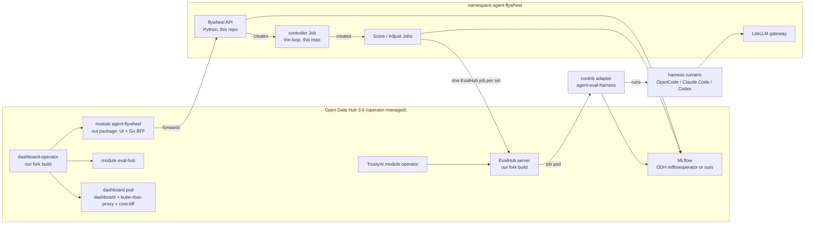

# Agent Flywheel OS: the integrated plan

Status: plan, written 2026-10-13, approved by Lukas the same day (section 2).
Nothing is built yet. Written by a Claude session in
`~/Projects/Github/lukaskellerstein/openshift-eval` for the agent that builds
it. Every fact names its source and its date; a line marked **verify** was
read in code or docs but never run.

## 0. Read this first

**What this is.** Agent Flywheel evaluates, benchmarks and trains AI agents:
CLI agent harnesses (OpenCode, Claude Code, Codex) with a "brain" (an
`AGENTS.md` and up to 3 skills, plain text, no weights), talking to any model
through a gateway. Training means a loop: score the agent on tickets, let a
second agent rewrite the brain from the judges' reasons, score again, keep or
revert. The first version, `openshift-eval`, built all of it alone. This
repo builds the integrated version: every gap goes into Red Hat's own
open-source projects (agent-eval-harness, EvalHub, the TrustyAI operator,
the OpenShift AI dashboard) as small PRs from Lukas's forks, the cluster
runs the real Open Data Hub stack, and this repo holds only the glue.

**Where things are.**

| What | Where |
|:--|:--|
| This plan and the glue | `~/Projects/Github/lukaskellerstein/agent-flywheel-os` (this repo) |
| The first version, the inspiration | `~/Projects/Github/lukaskellerstein/openshift-eval`, branch `main`. Its `PLAN.md` (every decision and measured fact), `CLUSTER.md` (cluster runbook), `flywheel/README.md` (the loop's contract) |
| The evidence behind this plan | [`docs/research.md`](docs/research.md): every fact read in upstream code and docs, with file and line |
| The first spec, archived | [`docs/archive/03-upstream-first.md`](docs/archive/03-upstream-first.md), word for word from the discarded `openshift-eval` branch `redesign-redhat-upstream`; this plan wins where they differ |
| The Slack post to colleagues | [`docs/outreach.md`](docs/outreach.md): the drafts, the fact-check, the blog fixes |
| Lukas's forks | `github.com/lukaskellerstein/` `agent-eval-harness`, `eval-hub`, `eval-hub-contrib`, `trustyai-service-operator`, `odh-dashboard` (made 2026-10-13, each still equal to upstream) |
| Fork clones, where all work happens | `~/Projects/Github/lukaskellerstein/forks/<repo>`, one per fork, `origin` = the fork, `upstream` = the original; cloned by the commands in section 5. No separate upstream clones: `git fetch upstream` gives `upstream/main` to read and to branch from (Lukas, 2026-10-13). The first clones in `~/Projects/Github/lukaskellerstein/upstream/` are dropped |
| Reference checkouts (read-only, never branch there) | `~/Projects/Github/redhat/agent-eval-harness` (it is `openshift-eval`'s editable dependency), `~/Projects/Github/eval-hub/eval-hub` |

**Done on 2026-10-13:** the analysis, the five forks on GitHub, three
opening comments drafted (section 13, not posted), and the decisions of
section 2. The forks are not cloned yet (section 5).

**Not done:** everything in section 6. The cluster `cluster-vj7vb` did not
answer on 2026-10-13 (API timeouts); it may be stopped or gone.

**The next step:** phase 0 (section 6): the cluster, the remotes, this
repo's agent setup.

**Rules for every agent working on this plan.**

- Never commit unless Lukas asks for that commit. Pushes: only branches to
  his forks (section 5), never to `upstream`, never to `main`, never
  `--force` (Lukas, 2026-10-13). A PR, a fork, an issue or a public comment
  needs his explicit go each time.
- One Claude session per repo, started in that repo's folder. A session
  started in another repo's worktree cannot run git here: its worktree guard
  refuses git in any other folder, `!` commands included (seen 2026-10-13).
- Every change on a cluster (`apply`, `create`, `delete`, `patch`, operator
  installs) is asked for first, naming the cluster and the namespace.
  Cluster-admin work is Lukas's or runs under his login.
- A paid model run beyond one smoke call is asked for first, with its cost
  (section 10 has the measured costs).
- No key in any file. Model keys live in Secrets that Lukas creates; a
  versioned secret is SOPS + age only.
- Upstream rules win inside an upstream repo (section 5, "Contribution
  rules").
- When a fact here turns out wrong, fix this file in the same turn and say
  so.

## 1. Goal

Agent Flywheel inside OpenShift AI, built from its own pieces:

1. **Evaluate** a CLI agent with its brain on a ticket set, with code
   judges and an LLM judge, a reason per ticket, traces in MLflow.
2. **Benchmark** agents × models × brains, with exact reuse of runs already
   measured.
3. **Train** the brain in a loop: score, adjust, keep or revert on the train
   score, a validation set that never decides, versioned brains.
4. **A UI inside the OpenShift AI dashboard**, as a dashboard module, on a
   cluster with the real Open Data Hub stack.

What makes it worth doing (Lukas's pitch): this training touches no
weights, so it runs on plain CPU pods; every cluster has CPU, not every
cluster has GPUs. EvalHub (GA in Red Hat AI 3.5) evaluates a model endpoint
or recorded traces; agent-eval-harness evaluates agents but is an upstream
project, not a product; Training Hub lists GEPA prompt optimization. None of
them puts a CLI agent harness under test in a loop. The headline result of
the first version: same model, same weights, one changed text file, a
support agent from 0.649 to 0.910 on 10 held-out tickets
(`openshift-eval` `CLUSTER.md`, run `flywheel-8l25r`, 2026-10-06).

## 2. Decisions (Lukas, 2026-10-13)

1. **Play along.** "I am totally okay to contribute to these projects instead
   of trying to replace them." Each gap goes upstream into the project that
   owns the topic.
2. **Build and prove first, PRs last.** Every change is built on a fork
   branch and proven with the flywheel running on all of them together
   before any PR. One branch per contribution, from upstream `main`; one
   `flywheel-integration` branch per repo that merges them (section 5).
3. **Forks and pushes.** Five forks on his account; pushes to them allowed
   within the limits of section 0.
4. **The UI in the dashboard from the start.** "I want to have my own UI
   from the start … so we can have our own UI elements in the OpenShift AI.
   I feel like this is an important experience for us." The UI is a module
   of his fork of `opendatahub-io/odh-dashboard`, not a separate console.
5. **The real stack.** Open Data Hub 3.6 with the dashboard and TrustyAI on
   the cluster, not hand-applied dashboard manifests with faked platform
   objects ("A - the real stack - rewrite our rules in CLUSTER.md if
   needed"). The standalone TrustyAI operator of `openshift-eval` goes away
   there.
6. **The module's backend forwards first.** The module's Go backend (its
   BFF) forwards to a Python flywheel API at first, so no logic is rewritten
   twice.
7. **A new home.** "Everything about this new integration belongs to the
   agent-flywheel-os repository … `openshift-eval` will serve the purpose of
   inspiration." `openshift-eval` keeps working as it is.
8. **Training Hub: no change now.** Its GEPA runs GEPA's whole search, has no
   single-proposal step, and pulls torch and CUDA (173 packages for
   `training-hub[gepa]==0.11.0`); the flywheel keeps calling `gepa` 0.1.4
   directly.

## 3. The lineup on 2026-10-13

| Project | Status | Latest | Notes |
|:--|:--|:--|:--|
| Open Data Hub operator | ODH 3.6.0-ea.2 (2026-09-22) is the only release declared for OpenShift 4.22; 3.5.0 GA covers 4.19 to 4.21 | 3.6.0-ea.2, channel `fast-3` (**verify**) | Modules on its `main`: aigateway, aihub, aipipelines, dashboard, data, databaseservice, kserve, mcplifecycleoperator, mlflowoperator, monitoring, ogx, ray, sparkoperator, trainer, trustyai, workbenches (`internal/controller/modules/`) |
| EvalHub | GA in Red Hat AI 3.5 (press release, 3.5 release notes); managed by the TrustyAI module | server 1.0.2 (2026-09-18), SDK `eval-hub-sdk` 1.0.6 (2026-10-13) | A job evaluates a `ModelRef` or `pre_recorded_data`; 16 built-in providers; no provider runs a CLI agent |
| agent-eval-harness | Upstream only (`opendatahub-io`), a Claude Code plugin; no product page names it | v1.56.1 (2026-10-12) | Runners `claude-code`, `codex`, `cursor`, `cli`, `responses-api`; maintainer astefanutti merges most PRs |
| TrustyAI operator | Upstream release v1.38.0 (2025-06) has no EvalHub; ODH and the RHOAI branches `rhoai-3.4` and later have it | `main` | `openshift-eval` pinned `main` at `359bc8e` |
| OpenShift AI dashboard (`odh-dashboard`) | The OpenShift AI UI; a monorepo of modules under `packages/` plus `dashboard-operator/` | `main` | Node 22, pnpm 11.22.0, Go 1.26 |
| Training Hub | 3.5 release notes list "automated prompt optimization for agentic systems … by using Training Hub"; the 3.5 images pin 0.9.2 without `[gepa]` | 0.11.0 (2026-10-12) | A Python library and the `thub` CLI, no UI |
| MLflow | A managed component of OpenShift AI since 3.4 (ODH module `mlflowoperator`) | — | `openshift-eval` runs its own MLflow 3.16.1 |

## 4. Target architecture

| Part | Code lives in | Built from | Deployed by |
|:--|:--|:--|:--|
| Dashboard host, dashboard-operator, module `agent-flywheel` | fork `odh-dashboard` | BuildConfigs on the cluster, from `flywheel-integration` | ODH operator, with our images through `RELATED_IMAGE_*` |
| EvalHub server | fork `eval-hub` | BuildConfig | TrustyAI module, `RELATED_IMAGE_ODH_EVAL_HUB_IMAGE` |
| EvalHub provider for the harness | fork `eval-hub-contrib` (`adapters/agent-eval-harness`) | BuildConfig | provider YAML and ConfigMap (section 7, C11) |
| Harness with our runners | fork `agent-eval-harness` | pip from the fork branch, inside the runner image | — |
| The loop, the flywheel API, the dataset, the runner image, the gateway | this repo | BuildConfig | kustomize in this repo |

## 5. Repos, branches, rules

**Clones and remotes.** Every fork is cloned into
`~/Projects/Github/lukaskellerstein/forks/`, with `origin` = Lukas's fork and
`upstream` = the original, by `scripts/clone-forks.sh`. Lukas runs it in his
own terminal: a Claude session's worktree guard refuses git in another
folder. The script is safe to run again (an existing clone is only fetched)
and stops when a clone's `origin` is not the fork. A sixth fork ("A sixth
fork, maybe" below) is one more line in its `REPOS` list.

Upstream code is read from `upstream/main` in the fork clone. The read-only
reference checkouts of `openshift-eval` stay where they are and are never
branched: `~/Projects/Github/redhat/agent-eval-harness` is `openshift-eval`'s
editable dependency, so a branch switch there changes that repo's
environment. A plain upstream clone of a project without a fork (Training
Hub) belongs under `~/Projects/Github/redhat/`, if one is ever needed.

**Branches.** Per contribution one branch from `upstream/main`, named after
it (`fix/stop-on-sigterm`). Per repo one `flywheel-integration` branch that
merges every contribution branch of that repo; it is only for us and never a
PR. A reviewer's change goes into the contribution branch, is merged into
`flywheel-integration` again, and the proof (phase 6) runs again. Before a
PR, the contribution branch is rebased on the newest `upstream/main`.

**A sixth fork, maybe.** The ODH operator hands the dashboard-operator a
fixed list of module image keys (`opendatahub-operator`,
`internal/controller/modules/dashboard/support.go`, read on `main`
2026-10-13: `RELATED_IMAGE_ODH_MOD_ARCH_EVAL_HUB_IMAGE`,
`…_AGENT_OPS_IMAGE` and others). A new module's key is not on it. Phase 5
checks whether the module can get its image another way; if not, fork
`opendatahub-io/opendatahub-operator` too (ask Lukas).

**Contribution rules** (read 2026-10-13):

| Repo | Rules |
|:--|:--|
| agent-eval-harness | No CONTRIBUTING file. Conventional commits (semantic-release). Spec-driven work in `specs/NNN` (spec → plan → tasks, `.specify/memory/constitution.md`). `make test` (pytest); CI also runs the `skillsaw` lint. No DCO on recent commits |
| eval-hub | An issue first for a new framework or an API change (`kind/architecture` + `status/accepted`, `CONTRIBUTING.md:112-140`). Conventional commits (commitlint). `git commit -s` by convention. An `Assisted-by` line. `make clean test-all`, `pre-commit run --all-files`. Review by `@eval-hub/maintainers` |
| eval-hub-contrib | Commitlint; `make test-<name>`; a `provider.yaml` per adapter; its CI publishes the images. Template: the ATIF adapter, PR #152 (merged 2026-10-13): provider.yaml, main.py, Containerfile, requirements and lock, ruff.toml, offline `smoke_test.py`, `tests/`, Makefile targets image, push, test, smoke, lock |
| trustyai-service-operator | Read its CONTRIBUTING before the first change |
| odh-dashboard | Definition of Ready: a Jira, approval by the Dashboard Architect, UX sign-off. PR template Problem / Solution / Evidence with screenshots and a cluster check. OWNERS per area. `pnpm run test`, `test:unit`, `test:lint`, `test:contract`, Cypress mocked and e2e tests. A new module: the `/module-onboarding` skill, an entry in `dashboard-operator/internal/controller/modules.go`, `manifests/modules/<slug>`, a Konflux `.tekton` pipeline, `pnpm run validate:ports` |

A new dashboard module can run in the fork for a long time without merging:
it needs product approval. Do not promise a merged module.

## 6. Phases

Each phase ends with its Definition of Done (DoD), checked and written into
this file's status before the next phase starts.

### Phase 0: the ground

1. **Cluster.** Lukas restores `cluster-vj7vb` in the RHDP portal or orders a
   new one. A new one gets a bigger disk: the single node's 100 GB disk hit
   disk pressure at about 80% used, each image build adds about 5 GB, and
   this plan adds 4 or more images (dashboard, modules, operator, EvalHub,
   adapter). The RHDP item used so far: "OpenShift Container Platform
   Cluster (Multi-Cloud)", single node, OpenShift 4.22, no GPU.
2. **Fork clones**: Lukas runs `scripts/clone-forks.sh` (section 5).
3. **This repo's agent setup.** Lukas sets up `CLAUDE.md` and `.claude/` the
   way his other repos have them (his mac-setup templates). On 2026-10-13
   the shared part arrived, not committed: `.claude/hooks/` (the worktree
   guard, the Playwright hooks) and the shared rules in `.claude/rules/`
   (`03-plan`, `08-report`, `09-code-quality`, `11-communication`,
   `12-security`, `lsp`, `machine-tools`, `memory`, `worktree`). Still
   missing: `CLAUDE.md` and the project rules (`01-project-config`,
   `02-understand`, `05-implement`, `06-testing`, `10-tech-stack`). Until
   they exist, section 0's rules apply. Do not invent a rules framework.
4. **The agent's own cluster identity.** Port `scripts/agent-kubeconfig.sh`
   and `deploy/agent-access/` from `openshift-eval` (a ServiceAccount
   `claude-agent`, admin in `agent-flywheel` only, a 24 h token in a
   kubeconfig outside the repo). Lukas approves the RBAC. Every `oc` call of
   an agent uses that identity, never Lukas's `~/.kube/config`.

DoD: `oc whoami --show-server` answers with the agent's identity; every
clone shows the fork as `origin`; the repo has its agent instructions.

### Phase 1: the platform

All cluster-admin; Lukas runs it or approves each step.

1. If the cluster has `openshift-eval`'s TrustyAI operator
   (`deploy/evalhub/operator`, namespace `trustyai-operator`), remove it and
   its `EvalHub` resource first: ODH's TrustyAI module manages the same
   CRDs.
2. Install the ODH operator 3.6.0-ea.2 from the community catalog
   (**verify** the package name `opendatahub-operator` and the channel).
3. A `DataScienceCluster` (`datasciencecluster.opendatahub.io/v2`) with
   `dashboard` and `trustyai` `Managed` and every other module `Removed`;
   `mlflowoperator` `Managed` if step 5 picks ODH's MLflow. Check whether a
   `DSCInitialization` is created for us (**verify**).
4. Check: the dashboard opens through ODH's Gateway login; the `eval-hub`
   module's page shows after `disableLMEval: false` in
   `OdhDashboardConfig` `spec.dashboardConfig`; an `EvalHub` resource can be
   created and its server answers.
5. **MLflow.** Try ODH's MLflow first: it supports workspaces, and EvalHub
   injects `MLFLOW_WORKSPACE` into every job pod, which `openshift-eval`'s
   own MLflow 3.16.1 refuses (eval-hub `job_config.go:149-157`). If it does
   not fit, deploy MLflow as `openshift-eval` does (`deploy/base/mlflow`).
6. **Namespace `agent-flywheel`**, Secrets `cerebras` and `openrouter`
   (Lukas creates them; the keys never enter a file), and the LiteLLM
   gateway, ported from `openshift-eval` `deploy/gateway/` (its
   `config/litellm.yaml` and `config/cerebras_hook.py` hold every model
   alias and price).

DoD: the dashboard works for Lukas; an EvalHub job of a built-in provider
runs and logs to MLflow; the gateway answers one smoke call (about 0.001
USD).

### Phase 2: harness contributions

In the `agent-eval-harness` fork, one branch each, in this order (section 7
has the details): C1 stop on SIGTERM, C2 price override, C3 gateway recipes
and a workspace without `input.yaml`, C4 SDK pin, C5 OpenCode runner (only
after astefanutti answers on PR #90), C6 trace adapters, C7 EvalHub adapter
fixes, C8 `runner` as an ANOVA factor with reuse, C9 an `/eval-optimize`
no-verify mode. Each: reproduce the gap first with a fake agent, then fix,
add tests, `make test`.

DoD: every branch green on `make test`; `flywheel-integration` merges them
all and stays green.

### Phase 3: EvalHub, contrib, operator

C10 `K8sRuntime` json tags, C12 local runtime fails on a silent provider
exit, C13 `MLFLOW_WORKSPACE` only when probed (skip if phase 1 picked ODH's
MLflow and it works), C11 the `agent-eval-harness` adapter in
`eval-hub-contrib` (an issue labelled `kind/architecture` in `eval-hub`
first, for its provider YAML), C14 the operator's failure watcher. Build
the EvalHub server and the adapter on the cluster from
`flywheel-integration`; point ODH at our EvalHub image with
`RELATED_IMAGE_ODH_EVAL_HUB_IMAGE` on the ODH operator (**verify** how:
the Subscription's `spec.config.env` is the likely place).

DoD: each repo's tests green; on the cluster an EvalHub job with our adapter
runs the harness on the smoke tickets and logs a reason per ticket to
MLflow.

### Phase 4: the glue in this repo

Port from `openshift-eval`, slimmed to use the enhanced pieces:

- `datasets/support/`: `eval/support/` (cases, `splits.yaml`, policies,
  `eval.yaml`), `agent/` (the brain v0 and `kb/`), `adjuster/`.
- `images/runner/`: the runner image, as `openshift-eval`
  `deploy/build/Containerfile`, but the harness from the fork's
  `flywheel-integration` branch and without our own runner scripts once
  C3 and C5 replace them.
- `flywheel/`: the loop (`controller.py`, `adjust.py`, the Adjust backends
  `adjuster`, `gepa`, `eval-optimize`), with one Score backend: EvalHub with
  our adapter. Keep or revert stays code (`controller.py` `decide()`, line
  262 in `openshift-eval`): keep when the train score is at least the best,
  validation never decides.
- `services/flywheel-api/`: the Python API the module forwards to, ported
  from `openshift-eval` `ui/server/` (API only, no static app).
- `deploy/`: kustomize for the namespace's parts and the BuildConfigs.

This layout is a proposal; agree it with Lukas before phase 4 starts.

DoD: a free smoke loop (local Gemma or the cheapest route) runs end to end
on the cluster through EvalHub, and its MLflow records have the same shape
as `openshift-eval`'s (runs, params, metrics, a trace per ticket, the
adjuster trace).

### Phase 5: the dashboard module

1. **Design first.** Every new screen goes on the Design canvas for Lukas's
   review before it is built (his standing rule). The screens to carry over
   are `openshift-eval`'s console: Evaluate (list, new, detail with the
   release gate, one ticket, online), Benchmark (list, new with reuse and an
   estimate, the grid), Train (list, new, run, Score and Adjust steps,
   Brains). The Claude Design connector failed to connect on 2026-10-13
   (403); Lukas runs `/design-login`.
2. **Where it sits.** `agent-ops` is the dashboard's agent module: its
   "agent" is an OpenShell `Sandbox` (`agents.x-k8s.io/v1beta1`) on the
   AI hub › Agents page, behind the `agentOps` flag (default off). Our agents
   are a harness plus a brain run as Jobs, so we do not join that package;
   our pages are our own tabs on the same Agents page through the
   `app.tab-route/tab` extension (**verify**).
3. **The package.** `packages/agent-flywheel` in the fork, a federated
   remote shaped like `packages/eval-hub`: a frontend and a Go BFF in one
   image (`packages/<m>/Dockerfile.workspace`, built from the repo root,
   `CGO_ENABLED=1`). The BFF forwards to `services/flywheel-api` (decision
   6). A feature flag hides it by default.
4. **Registration.** An entry in `dashboard-operator/internal/controller/modules.go`
   (fields `Name`, `ContainerName`, `Port`, `ImageEnvVar`, `ManifestSlug`;
   ports taken on 2026-10-13: 8043, 8143, 8243, 8343, 8543, 8643, 8843;
   check with `pnpm run validate:ports`), and `manifests/modules/agent-flywheel`
   modelled on `manifests/modules/eval-hub`. Then the image key question of
   section 5.
5. **Build.** The host, the module and the dashboard-operator from the same
   commit of `flywheel-integration`: the host and its remotes are
   version-locked (`docs/module-federation.md`). Build on the cluster (the
   Mac is arm64, the node x86_64); the host build needs an 8 GB Node heap,
   so give that build at least 10 GiB of memory.
6. **Dev loop.** Day to day: `cd packages/agent-flywheel && make dev-start`
   (standalone, a mocked BFF, no cluster). Then federated:
   `pnpm run dev:backend`, `pnpm run dev:frontend` and
   `make dev-start-federated` in the package, opened on `localhost:4010`;
   this needs a cluster-admin login, so Lukas runs it. Then the cluster:
   `oc start-build` and a rollout.

DoD: on the cluster, the dashboard shows the Agent Flywheel tabs; Lukas
starts an evaluation and a smoke training run from them; the pages show the
same numbers as MLflow.

### Phase 6: the proof

On the `flywheel-integration` branches of every fork, in this order:

1. A record comparison like `openshift-eval`'s phase tests (they lived in
   its gitignored `tmp/tests/`; `openshift-eval` `PLAN.md` section 0 says
   what they checked): the same MLflow runs, params, metrics and traces as
   before the switch, with fakes for the agents and the gateway.
2. One free loop on the local Gemma with the local judge (laptop).
3. One paid smoke run on Qwen through Cerebras, about 0.2 USD (asked first).
4. The same smoke run on the cluster, started from the dashboard module.

DoD: all four green, with the run ids written here.

### Phase 7: the PRs

One PR per contribution branch, rebased on `upstream/main`, in the order of
section 7, each with its own tests and evidence. The three comments of
section 13 go out before any PR. When a PR merges, the dependency here moves
from the fork branch to the upstream release.

### Phase 8: where the loop lives

Decide with the maintainers' answers: the harness's `/eval-optimize` (a loop
in code with a held-out set, near PR #73), Training Hub (an agent
optimization algorithm with EvalHub as the evaluator), or a controller
behind the dashboard module. The demo (dataset, judges, manifests) stays
ours, here or as a Red Hat AI quickstart (`github.com/rh-ai-quickstart`).

## 7. Contribution catalogue

Read in upstream code on 2026-10-13. "Replaces" names what it lets us drop
from the `openshift-eval` design.

| Id | Repo | Gap today (source) | Change | Replaces |
|:--|:--|:--|:--|:--|
| C1 | harness | The `cli` and Codex runners kill their process group only on a timeout (`cli_runner.py:152-163`, `codex.py:210-262`); `execute.py` has no SIGTERM handler; the Claude Code runner kills the CLI but not its children (`claude_code.py:412`). A stopped evaluation leaves agents running | A SIGTERM handler, a group kill on every exit; propose a parent-death watchdog for SIGKILL | `stop_with_parent` in `eval/support/scripts/lib.sh` |
| C2 | harness | Claude Code prices every token as Claude (`claude_code.py:948-956`); Codex looks the model up in `litellm.model_cost`, `None` for a gateway alias (`codex.py:571-592`) | A price override per runner | `eval/support/scripts/prices.sh` and the cost code in the runners |
| C3 | harness | The gateway works by env (`ANTHROPIC_BASE_URL`, `OPENAI_BASE_URL`, `runner.settings`) but is not documented or tested; the agent always runs in the case folder next to `input.yaml` (issues #150, #151) | Gateway recipes with tests; a workspace option without `input.yaml` | `run-claude-code.sh`, `run-codex.sh` |
| C4 | harness | Pins `eval-hub-sdk[adapter]>=0.1.7,<1.0` (`pyproject.toml:25,45`) | `>=1.0.6,<2` | — (unblocks C7, C11) |
| C5 | harness | Draft PR #90 (astefanutti, last update 2026-06-10, 580 commits behind): copies all of `os.environ`, runs `--dangerously-skip-permissions`, writes `opencode.json` next to `input.yaml`, no process group; `events.py` parses no OpenCode events | A runner rebased from #90 without its OTel part, with an env allowlist, permissions from config, its own config folder and process group, `execute()`, cost from `step_finish`, OpenCode in `events.py`. Only after astefanutti agrees | `run-opencode.sh` |
| C6 | harness | `/eval-mlflow` builds traces from Claude Code stream-json and Harbor trajectories only (`log_results.py:514-540`) | Per-format adapters before `build_trace` for OpenCode, Codex, `cli` | The trace code of `flywheel/run_eval.py` (lines 760-914) |
| C7 | harness | Its EvalHub adapter returns per-judge means only, runs cases one at a time, swallows a judge error (`adapter.py:107-120`); its image `quay.io/rhoai/agent-eval-hub` is not public | Per-case reasons, a run-folder export, parallel cases, fail on a judge error | — (feeds C11) |
| C8 | harness | `/eval-anova`: `runner.type` fixed for the whole matrix, a factor named `agent` shadowed by the `{agent}` placeholder, no reuse (`matrix-schema.md:31-39`, `orchestrate.py:111-123`) | `runner` as a factor; skip a cell whose recipe hash has a run | Most of `flywheel/benchmark.py` |
| C9 | harness | `/eval-optimize` always re-runs `/eval-run` | An `--artifact` / no-verify mode | The workarounds in `flywheel/backends/adjust_eval_optimize.py` |
| C10 | eval-hub | `K8sRuntime` in `pkg/api/providers.go:115-127` has no json tags, so the API drops the four resource fields the OpenAPI schema names | Add the json tags | A provider registered by ConfigMap only |
| C11 | eval-hub-contrib (+ eval-hub YAML, + operator ConfigMap) | No provider runs a CLI agent harness | An `agent-eval-harness` adapter on the ATIF template (PR #152), running the harness's eval-run scripts as a subprocess, with per-ticket reasons and the run folder in MLflow | The provider half of `flywheel/backends/score_evalhub.py` (lines 335-441) and its `provider.yaml` |
| C12 | eval-hub | The local runtime ignores a provider that exits without a report (`local_runtime.go:414`, `_ = cmd.Wait()`); the job stays pending | Fail the benchmark | A known gap |
| C13 | eval-hub | The server injects `MLFLOW_WORKSPACE` into every job pod (`job_config.go:149-157`); an MLflow without workspaces refuses the header | Inject only when the probe says workspaces are on | `export_run_folder` in `score_evalhub.py` (with SDK 1.0.6 `MlflowFileArtifact`) |
| C14 | trustyai-service-operator | The failure watcher ignores an adapter's non-zero exit (reconciler, lines 113-114) | Post `failed` when the benchmark is not terminal | A job that stays running |
| C15 | odh-dashboard (+ maybe opendatahub-operator) | No UI for agents under test, benchmarks of harnesses, or brain training | The `agent-flywheel` module (phase 5) | `openshift-eval` `ui/` |

Not contributions: keep or revert stays ours (comment on PR #73 instead);
`adjust_gepa.py` keeps the direct `gepa` call (decision 8); Harbor trial
pods (`openshift-eval` `flywheel/backends/score_harbor.py`, `TrialPod`) feed
EvalHub's sandbox ADR as a comment (section 13), not as code.

## 8. Sandboxing

EvalHub's ADR 0001 "Sandboxed evaluation runtime for agentic frameworks"
(draft PR #1059, julpayne, 2026-10-01, no review yet) proposes P0 a namespace
per evaluation with an `eval-sandbox-broker`, P1 OpenShell, P2 Kata, and names
Harbor and Terminal-Bench. `openshift-eval` `docs/my-specs/XX-sandboxing.md`
designed the same two layers (OpenShift sandboxed containers with Kata for
the kernel, NVIDIA OpenShell for policy and audit). So no second sandbox
here: help on the ADR, starting with the comment of section 13.

## 9. Reuse map from openshift-eval

| `openshift-eval` path | What it is | Here |
|:--|:--|:--|
| `eval/support/` | Cases, splits, policies, `eval.yaml` with 6 judges, runner scripts | `datasets/support/`; the scripts go when C3 and C5 land |
| `agent/`, `adjuster/` | The brain v0 with `kb/`; the adjuster agent | `datasets/support/` |
| `flywheel/controller.py`, `adjust.py`, `backends/adjust_*.py` | The loop and the Adjust backends | `flywheel/` |
| `flywheel/run_eval.py`, `backends/score_*.py` | The Score step and its backends | One Score backend on EvalHub with C11; the trace code goes with C6 |
| `flywheel/benchmark.py` | The grid with reuse | Kept until C8 |
| `flywheel/templates/`, `deploy/flywheel/`, `deploy/evaluate/` | The Job templates | `flywheel/templates/`, `deploy/` |
| `deploy/gateway/` | LiteLLM with every alias and price | `deploy/gateway/` |
| `deploy/base/mlflow` | Our MLflow | Only if phase 1 does not pick ODH's |
| `deploy/build/Containerfile` | The runner image | `images/runner/` |
| `deploy/agent-access/`, `scripts/agent-kubeconfig.sh` | The agent's own identity | Phase 0 |
| `deploy/evalhub/` | The standalone TrustyAI operator and our provider | Replaced by ODH and C11 |
| `ui/server/` | The console's FastAPI API | `services/flywheel-api/` |
| `ui/web/` | The React console | The screens are the model for phase 5; the code is not reused (the dashboard uses PatternFly) |
| `PLAN.md` sections 0, 2, 7, 8 | Every decision, measured fact and the dataset design | Read before porting a part |

## 10. Costs and numbers

All measured in `openshift-eval` on Cerebras, without the judge unless said:

- A smoke training run (1 adjust step, 6 smoke tickets): about 0.2 USD.
- A full training run on 30 tickets, 3 to 5 adjust steps: 1.7 to 6.1 USD
  (`flywheel-ctpt6` 1.69, `phase6-cerebras-full-1` 1.92, `flywheel-8l25r`
  6.10).
- A benchmark grid of 3 agents × 4 models × 5 runs: 21 minutes, 5.39 USD for
  the agents (`bench-4j9l7`).
- The free route: Gemma 4 26B on Unsloth on the laptop as agent, adjuster
  and judge (`EVAL_JUDGE=local`), 0 USD.

## 11. Risks

1. **ODH 3.6 is early access.** APIs and the dashboard's platform checks can
   change between releases. Pin the operator version and the dashboard
   commit, and record both here.
2. **The module may never merge.** It needs product approval (section 5).
   It still runs in the fork.
3. **The single node's disk and memory.** The dashboard adds 4 to 5 pods and
   several images; the host build needs about 10 GiB. Check the disk before
   every build.
4. **Version lock.** Host, remotes and the dashboard-operator must come from
   the same commit; a partial rebuild breaks the module at runtime.
5. **A newer harness moves the scores.** v1.56.1 fences the LLM judge's
   prompt; every run made with an older harness stops counting for benchmark
   reuse. Take a fresh v0 baseline after the switch.

## 12. Verify first

Read but never run on 2026-10-13; check each before relying on it:

- The ODH package name, the channel and the install of 3.6.0-ea.2 on
  OpenShift 4.22; whether a `DSCInitialization` is created for us.
- `RELATED_IMAGE_*` overrides through the Subscription's `spec.config.env`.
- How a new module's image reaches the dashboard-operator (section 5, the
  sixth fork).
- The `app.tab-route/tab` extension on the Agents page.
- ODH's MLflow with the EvalHub SDK 1.0.6 artifacts and workspaces.
- Whether the gateway's Cerebras hook still covers every model the forks'
  runners send.

## 13. Opening comments (drafts, not posted)

Lukas posts them in his own voice, before any PR.

### agent-eval-harness PR #90, to astefanutti

> Hi @astefanutti, I run agent-eval-harness with OpenCode as the agent under
> test, today through the `cli` runner and my own wrapper script. It is a
> project that evaluates, benchmarks and trains agents on OpenShift
> (OpenCode, Claude Code and Codex through a LiteLLM gateway). I would like
> to help get a native OpenCode runner into `main`.
>
> Would you be OK if I rebased this PR's runner onto current `main`, without
> the OTel receiver, as a fresh PR? From what I hit in practice, I would
> change these points:
>
> - an env allowlist like the other runners, instead of a copy of
>   `os.environ`
> - OpenCode's permissions from its config, instead of
>   `--dangerously-skip-permissions`
> - the agent's config in its own folder, not in the case workspace next to
>   `input.yaml`
> - its own process group, killed on any exit
> - `execute()` instead of `run_skill`, the cost from `step_finish`, and the
>   OpenCode events in `events.py`
>
> If you would rather finish it yourself, I am happy to review it and test
> it against my setup instead.

### agent-eval-harness PR #73, to astefanutti and rhuss

> Hi @astefanutti, @rhuss, some data that may help with the question whether
> this ran end to end. I run an optimize loop around the harness: score on a
> train set and a held-out validation set, edit the agent's AGENTS.md and
> skills, score again, then keep or revert. The rule is code, not the LLM:
> keep if the train score is at least the best so far, revert otherwise.
> The validation set never decides, so it stays a clean held-out number, and
> the editor never judges its own edit.
>
> On 30 support tickets (20 train, 10 validation), Claude Code on Qwen 3.8
> 27B went from 0.649 to 0.910 on validation in 5 steps, with one candidate
> reverted. One caution for the gate: with sets this small, one run is not a
> measurement. In my benchmark, 5 repeated runs of one cell spread by about
> 0.05 (median).
>
> I would be glad to test this PR, or a smaller first tier (a held-out split
> and a score-based gate), against my setup.

### EvalHub PR #1059 (ADR 0001), to julpayne

> Hi @julpayne, a few data points from running Harbor trials as pods on
> OpenShift (single-node OCP 4.22, restricted-v2), in case they help the ADR:
>
> 1. Cleanup in the tenant namespace can be deterministic. Every trial pod
>    gets an ownerReference to the pod of the Job that started it, so a
>    suspended or deleted Job takes its trial pods with it. In my stop test
>    they were gone 36 s after the suspend, and a full run left no pod. That
>    may be worth a line next to the rejected tenant-namespace alternative.
> 2. Harbor's own cleanup is not enough. With Harbor 0.24 on Podman, a
>    SIGINT left 3 of 4 trial containers stopped but not removed. A reaper
>    owned by the broker or the operator looks right.
> 3. The verbs my trial pods needed: pods create, get, delete and pods/exec
>    create, get; no ServiceAccount token in the trial pod.
> 4. On OpenShift the SCC decides, not only PSA. Terminal-Bench style tasks
>    need root and the internet, so P0 will need an SCC story. I expect this
>    from the task images; I have not run it yet.
>
> I have a written design for the OpenShell (P1) and Kata (P2) layers, and I
> would be happy to help with either.

## 14. Sources

- Red Hat AI 3.5 press release:
  <https://www.redhat.com/en/about/press-releases/red-hat-puts-safety-and-observability-core-enterprise-ai-red-hat-ai-35>
- OpenShift AI 3.5 release notes:
  <https://docs.redhat.com/en/documentation/red_hat_openshift_ai_self-managed/3.5/html/release_notes/new-features-and-enhancements_relnotes>
- Evaluate AI agents with IBM CLEAR and EvalHub on OpenShift AI:
  <https://developers.redhat.com/articles/2026/09/03/evaluate-ai-agents-ibm-clear-evalhub-openshift-ai>
- EvalHub ADR 0001: <https://github.com/eval-hub/eval-hub/pull/1059>
- ATIF adapter: <https://github.com/eval-hub/eval-hub-contrib/pull/152>
- OpenCode runner draft: <https://github.com/opendatahub-io/agent-eval-harness/pull/90>
- Optimize strategies: <https://github.com/opendatahub-io/agent-eval-harness/pull/73>
- ODH operator modules: <https://github.com/opendatahub-io/opendatahub-operator/tree/main/internal/controller/modules>
- Dashboard modules: <https://github.com/opendatahub-io/odh-dashboard/tree/main/packages>
- Training Hub: <https://github.com/Red-Hat-AI-Innovation-Team/training_hub>
- Lukas's write-up and video of the first version:
  <https://www.kellerstein.org/blog/projects/agent-flywheel/>,
  <https://www.youtube.com/watch?v=VQWUJKX87vI>
