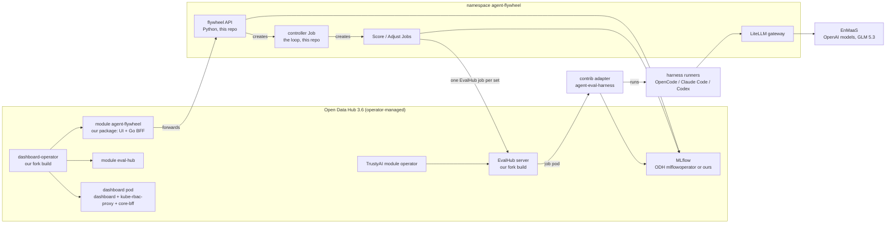

# Spec 01: Initial implementation, the integrated plan

**Closed on 2026-10-14.** This was `PLAN.md` until then (decision 14,
spec 02). Reopened the same evening for phase 2's C30 to C34, the upstream
bugs found while C1 to C9 were built (Lukas: "I would rather fix the 13
bugs now", `ok` to the plan), and closed again at 19:40 UTC with them
done. A second round, the gaps found while C30 to C34 were built,
started at 20:56 UTC and moved to spec 02 as C35 to C39 at about 21:50 UTC
(Lukas: none of it has to be done before spec 02, so it belongs there);
phase 2 status has what it did. Done: ✅ phase 0, ✅ phase 1 (with the gateway on EnMaaS, decision
9), and in phase 2 ✅ C1 to C4, C6 to C9 and C30 to C34;
re-checked on 2026-10-14 between 19:10 and 19:25 CEST (the status of each
phase). Every open step (C5, C19, phases 3 to 8) and decisions 10 to 13
continue in spec 02, [`02-generalization.md`](02-generalization.md), the
active plan.
What this spec says still holds where spec 02 does not change it: the rules
for every agent (section 0), decisions 1 to 9 (section 2), the lineup, the
architecture, repos and branches, the catalogue C1 to C18, sandboxing,
costs, risks, the opening comments.

Status until 2026-10-14: plan, written 2026-10-13, approved by Lukas the
same day (section 2). Written by a Claude session in
`~/Projects/Github/lukaskellerstein/openshift-eval` for the agent that builds
it. Every fact names its source and its date; a line marked **verify** was
read in code or docs but never run.

## 0. Read this first

**What this is.** Agent Flywheel evaluates, benchmarks and trains AI agents:
CLI agent harnesses (OpenCode, Claude Code, Codex) with a "brain" (an
`AGENTS.md` and up to 3 skills, plain text, no weights), talking to any model
through a gateway. Training means a loop: score the agent on the tasks of
a use case, let a second agent rewrite the brain from the judges' reasons,
score again, keep or revert. Any use case, not only the support tickets of
the first version (decision 10). The first version, `openshift-eval`, built all of it
alone. This
repo builds the integrated version: every gap goes into Red Hat's own
open-source projects (agent-eval-harness, EvalHub, the TrustyAI operator,
the OpenShift AI dashboard) as small PRs from Lukas's forks, the cluster
runs the real Open Data Hub stack, and this repo holds only the glue.

**Where things are.**

| What | Where |
|:--|:--|
| This plan and the glue | `~/Projects/Github/lukaskellerstein/agent-flywheel-os` (this repo) |
| The first version, the inspiration | `~/Projects/Github/lukaskellerstein/openshift-eval`, branch `main`. Its `PLAN.md` (every decision and measured fact), `CLUSTER.md` (cluster runbook), `flywheel/README.md` (the loop's contract) |
| The first version's generalization | `openshift-eval` branch `generalization`, worktree `.worktrees/generalization`: the spec `docs/my-specs/03-generalization.md` (a "task pack" per use case, decided there 2026-10-13; its "task" is our use case, its "case" our task), its phase 1 built and checked on the laptop (`tasks/support/`, `flywheel/task.py`). Not committed on 2026-10-14: the whole change, the moved support folders included, exists only in that worktree. Input for decision 10 |
| The evidence behind this plan | [`docs/research.md`](../research.md): every fact read in upstream code and docs, with file and line |
| The first spec, archived | [`docs/archive/03-upstream-first.md`](../archive/03-upstream-first.md), word for word from the discarded `openshift-eval` branch `redesign-redhat-upstream`; this plan wins where they differ |
| The Slack post to colleagues | [`docs/outreach.md`](../outreach.md): the drafts, the fact-check, the blog fixes |
| Lukas's forks | `github.com/lukaskellerstein/` `agent-eval-harness`, `eval-hub`, `eval-hub-contrib`, `trustyai-service-operator`, `odh-dashboard` (made 2026-10-13, each still equal to upstream) |
| Fork clones, where all work happens | `~/Projects/Github/lukaskellerstein/forks/<repo>`, one per fork, `origin` = the fork, `upstream` = the original; cloned by the commands in section 5. No separate upstream clones: `git fetch upstream` gives `upstream/main` to read and to branch from (Lukas, 2026-10-13). The first clones in `~/Projects/Github/lukaskellerstein/upstream/` are dropped |
| Reference checkouts (read-only, never branch there) | `~/Projects/Github/redhat/agent-eval-harness` (it is `openshift-eval`'s editable dependency), `~/Projects/Github/eval-hub/eval-hub` |

**Done on 2026-10-13:** the analysis, the five forks on GitHub, three
opening comments drafted (section 13, not posted), and the decisions of
section 2. The five forks are cloned into `forks/` (checked 17:36: each
`origin` is the fork, each `upstream` the original, all on `main`, partial
clones with `--filter=blob:none`). `scripts/clone-forks.sh` is written and
tested offline. Phase 0 is done (20:55): the agent's own identity is
cluster-admin on the new cluster `cluster-nm8mw` (its status in section 6).

**Not done:** everything else in section 6; phase 0 has its status there.
The cluster `cluster-vj7vb` (RHDP service
`published.ocp4-cluster.prod-tz4hq`) was auto-stopped Tue 2026-10-13 03:58
GMT+2, which is why its API timed out (17:48), and at 20:40 it was no
longer in RHDP "My Services". Its replacement is `cluster-nm8mw`, RHDP
service `bzdsg`, ordered from the same item at about 20:23 GMT+2. Its
auto-destroy is Thu 2026-11-12 18:00 GMT+1, the latest day the picker
offers (30 days), set by the agent at 21:10 at Lukas's word. Its auto-stop
is Thu 2026-10-15 02:23 GMT+2, moved by Lukas (read 21:17); that dialog
warns that a later stop costs his cost center more, so the agent's
classifier refused to move it. The auto-stop needs moving again before it
comes, or the cluster stops and its API times out. Larger sizes could not be
created; only the small one could (Lukas, 20:40). So it is again one node
with one 100 GB disk (phase 0 status).

**The next step (until 2026-10-14; now spec 02 section 0):** phase 3 (section 6). Phase 2, the harness
contributions, ran from this repo's session: the agent here orchestrates
subagents in the `agent-eval-harness` fork clone (section 5). C1 to C4 and
C6 to C9 are done and merged into `flywheel-integration` (2026-10-14);
their PRs wait for Lukas's go ([`docs/pr-drafts.md`](../pr-drafts.md)).
C5 waits for the opening comment on PR #90 (section 13, not posted), then for astefanutti; C19 is not started. Phases 0 and 1 are
done; their status is in section 6. EnMaaS is onboarded and measured
(decision 9, `scripts/enmaas/probe.py`), and every gateway route runs on
it since 2026-10-14, 16:04 UTC. Decisions 10 to 13 are taken (any use case; our
registry in S3, import first; the words; the task format and fixed
versions). Not planned yet: which other gaps of a general flywheel go to
which project, the registry's API and its screens.

**Rules for every agent working on this plan.**

- Never commit unless Lukas asks for that commit. One standing exception
  (Lukas, 2026-10-14): commits on the contribution branches and on
  `flywheel-integration` in the fork clones, never on `main`. Pushes: only
  branches to his forks (section 5), never to `upstream`, never to `main`,
  never `--force` (Lukas, 2026-10-13). A PR, a fork, an issue or a public
  comment needs his explicit go each time.
- The fork clones are worked on from this repo's session (Lukas,
  2026-10-14): `.claude/settings.json` opens
  `~/Projects/Github/lukaskellerstein/forks/` to the sandbox, and the agent
  here orchestrates subagents there, one checkout per repo and no git
  worktrees (section 5). `openshift-eval` and the reference checkouts stay
  read-only. A session
  started in a `claude -w` worktree still cannot run git in another folder,
  `!` commands included (seen 2026-10-13).
- The agent runs the cluster on its own (Lukas, 2026-10-13): its own
  identity is cluster-admin (phase 0 step 4), and a change on the cluster
  (`apply`, `create`, `delete`, `patch`, operator installs) needs no
  question. Each change is named in the report. Only that one cluster:
  `oc whoami --show-server` first, and never Lukas's `~/.kube/config`.
- A paid model run beyond one smoke call is asked for first, with its cost
  (section 10 has the measured costs).
- No key in any file. Model keys live in Secrets that Lukas creates; a
  versioned secret is SOPS + age only.
- Upstream rules win inside an upstream repo (section 5, "Contribution
  rules").
- When a fact here turns out wrong, fix this file in the same turn and say
  so.

## 1. Goal

Agent Flywheel inside OpenShift AI, built from its own pieces:

1. **Evaluate** a CLI agent with its brain on the tasks of a use case, with
   code judges and an LLM judge, a reason per task, traces in MLflow.
2. **Benchmark** agents × models × brains, with exact reuse of runs already
   measured.
3. **Train** the brain in a loop: score, adjust, keep or revert on the train
   score, a validation set that never decides, versioned brains.
4. **A UI inside the OpenShift AI dashboard**, as a dashboard module, on a
   cluster with the real Open Data Hub stack.
5. **Any use case** (decision 10): spec 02 section 1.

What makes it worth doing (Lukas's pitch): this training touches no
weights, so it runs on plain CPU pods; every cluster has CPU, not every
cluster has GPUs. EvalHub (GA in Red Hat AI 3.5) evaluates a model endpoint
or recorded traces; agent-eval-harness evaluates agents but is an upstream
project, not a product; Training Hub lists GEPA prompt optimization. None of
them puts a CLI agent harness under test in a loop. The headline result of
the first version: same model, same weights, one changed text file, a
support agent from 0.649 to 0.910 on 10 held-out tickets
(`openshift-eval` `CLUSTER.md`, run `flywheel-8l25r`, 2026-10-06).

## 2. Decisions (Lukas, 2026-10-13)

1. **Play along.** "I am totally okay to contribute to these projects instead
   of trying to replace them." Each gap goes upstream into the project that
   owns the topic. The rule for what is ours (Lukas, 2026-10-14): "In the
   first place if it's possible, we should update the upstream repos
   (whatever repo needs to be updated) and add the functionality there. If
   it's not possible to add it there or if it needs orchestration between
   two of these, then it belongs to our repo and to our code."
2. **Build and prove first, PRs last.** Every change is built on a fork
   branch and proven with the flywheel running on all of them together
   before any PR. One branch per contribution, from upstream `main`; one
   `flywheel-integration` branch per repo that merges them (section 5).
3. **Forks and pushes.** Five forks on his account; pushes to them allowed
   within the limits of section 0.
4. **The UI in the dashboard from the start.** "I want to have my own UI
   from the start … so we can have our own UI elements in the OpenShift AI.
   I feel like this is an important experience for us." The UI is a module
   of his fork of `opendatahub-io/odh-dashboard`, not a separate console.
5. **The real stack.** Open Data Hub 3.6 with the dashboard and TrustyAI on
   the cluster, not hand-applied dashboard manifests with faked platform
   objects ("A - the real stack - rewrite our rules in CLUSTER.md if
   needed"). The standalone TrustyAI operator of `openshift-eval` goes away
   there.
6. **The module's backend forwards first.** The module's Go backend (its
   BFF) forwards to a Python flywheel API at first, so no logic is rewritten
   twice.
7. **A new home.** "Everything about this new integration belongs to the
   agent-flywheel-os repository … `openshift-eval` will serve the purpose of
   inspiration." `openshift-eval` keeps working as it is.
8. **Training Hub: no change now.** Its GEPA runs GEPA's whole search, has no
   single-proposal step, and pulls torch and CUDA (173 packages for
   `training-hub[gepa]==0.11.0`); the flywheel keeps calling `gepa` 0.1.4
   directly.
9. **Everything through EnMaaS, OpenAI models first** (2026-10-14). "Any
   given agent that we are going to run in the OpenShift will use these
   [EnMaaS] models." Later the same day: "let's use the OpenAI models
   everywhere possible … Let's not use Cerebras anymore", so that
   "everything can be run through the EnMaaS". Every model call the
   flywheel makes on the cluster, from the agents, the adjuster and the
   judge, goes to EnMaaS through the gateway, on an OpenAI model wherever
   the caller's API dialect allows it (`docs/research.md`, "EnMaaS,
   measured"). Cerebras is no longer a route. GLM 5.3 (`enmaas-glm-5-3`),
   EnMaaS's only model with no usage cost, stays as the free route for
   tests. The OpenAI models count against Lukas's Red Hat AI budget, so
   the money rule of section 10 holds. The key is Lukas's, in the Secret
   `enmaas`. The roles (Lukas, 2026-10-14): the agents on `gpt-5-mini`
   (`enmaas-gpt-5-mini`), the adjuster on `gpt-6-luna`
   (`enmaas-gpt-6-luna`); the judge on `gpt-6-sol` (`enmaas-gpt-6-sol`),
   the agent's pick, since Lukas named only the other two and the judge
   must not be the agent's own model.
Decisions 10 to 13 (2026-10-14, the generalization) moved to spec 02
section 2, with decision 14 (this split into specs). The numbering goes on
there; where this spec names decisions 10 to 14, read them there.

## 3. The lineup on 2026-10-13

| Project | Status | Latest | Notes |
|:--|:--|:--|:--|
| Open Data Hub operator | ODH 3.6.0-ea.2 (2026-09-22) is the only release declared for OpenShift 4.22; 3.5.0 GA covers 4.19 to 4.21 | 3.6.0-ea.2, channel `fast-3` (installed 2026-10-13) | Modules on its `main`: aigateway, aihub, aipipelines, dashboard, data, databaseservice, kserve, mcplifecycleoperator, mlflowoperator, monitoring, ogx, ray, sparkoperator, trainer, trustyai, workbenches (`internal/controller/modules/`) |
| EvalHub | GA in Red Hat AI 3.5 (press release, 3.5 release notes); managed by the TrustyAI module | server 1.0.2 (2026-09-18), SDK `eval-hub-sdk` 1.0.6 (2026-10-13) | A job evaluates a `ModelRef` or `pre_recorded_data`; 16 built-in providers; no provider runs a CLI agent |
| agent-eval-harness | Upstream only (`opendatahub-io`), a Claude Code plugin; no product page names it | v1.56.1 (2026-10-12) | Runners `claude-code`, `codex`, `cursor`, `cli`, `responses-api`; maintainer astefanutti merges most PRs |
| TrustyAI operator | Upstream release v1.38.0 (2025-06) has no EvalHub; ODH and the RHOAI branches `rhoai-3.4` and later have it | `main` | `openshift-eval` pinned `main` at `359bc8e` |
| OpenShift AI dashboard (`odh-dashboard`) | The OpenShift AI UI; a monorepo of modules under `packages/` plus `dashboard-operator/` | `main` | Node 22, pnpm 11.22.0, Go 1.26 |
| Training Hub | 3.5 release notes list "automated prompt optimization for agentic systems … by using Training Hub"; the 3.5 images pin 0.9.2 without `[gepa]` | 0.11.0 (2026-10-12) | A Python library and the `thub` CLI, no UI |
| MLflow | A managed component of OpenShift AI since 3.4 (ODH module `mlflowoperator`) | — | `openshift-eval` runs its own MLflow 3.16.1 |
| EnMaaS (joined 2026-10-14, decision 9) | Red Hat's internal model service, `https://api.enmaas.devshift.net/v1`; every model call of the flywheel on the cluster goes there through the gateway | Read 2026-10-14 (`scripts/enmaas/models.md`) | Chat Completions, Responses and Anthropic Messages; no legacy `/completions`. OpenAI models pass through to OpenAI; GPT-6 only under code names (`gpt-6-sol`, `gpt-6-luna` and others), with no list price. GLM 5.3 is free (`docs/research.md`, "EnMaaS, measured") |

## 4. Target architecture

| Part | Code lives in | Built from | Deployed by |
|:--|:--|:--|:--|
| Dashboard host, dashboard-operator, module `agent-flywheel` | fork `odh-dashboard` | BuildConfigs on the cluster, from `flywheel-integration` | ODH operator, with our images through `RELATED_IMAGE_*` |
| EvalHub server | fork `eval-hub` | BuildConfig | TrustyAI module, `RELATED_IMAGE_ODH_EVAL_HUB_IMAGE` |
| EvalHub provider for the harness | fork `eval-hub-contrib` (`adapters/agent-eval-harness`) | BuildConfig | provider YAML and ConfigMap (section 7, C11) |
| Harness with our runners | fork `agent-eval-harness` | pip from the fork branch, inside the runner image | — |
| The loop, the flywheel API, the dataset, the runner image, the gateway | this repo | BuildConfig | kustomize in this repo |

## 5. Repos, branches, rules

**Clones and remotes.** Every fork is cloned into
`~/Projects/Github/lukaskellerstein/forks/`, with `origin` = Lukas's fork and
`upstream` = the original, by `scripts/clone-forks.sh` (the clones of
2026-10-13 were made before it existed, phase 0 status). Lukas runs it in his
own terminal: a Claude session's worktree guard refuses git in another
folder. The script is safe to run again (an existing clone is only fetched)
and stops when a clone's `origin` is not the fork. A sixth fork ("A sixth
fork, maybe" below) is one more line in its `REPOS` list.

Upstream code is read from `upstream/main` in the fork clone. The read-only
reference checkouts of `openshift-eval` stay where they are and are never
branched: `~/Projects/Github/redhat/agent-eval-harness` is `openshift-eval`'s
editable dependency, so a branch switch there changes that repo's
environment. A plain upstream clone of a project without a fork (Training
Hub) belongs under `~/Projects/Github/redhat/`, if one is ever needed.

**Branches.** Per contribution one branch from `upstream/main`, named after
it (`fix/stop-on-sigterm`). Per repo one `flywheel-integration` branch that
merges every contribution branch of that repo; it is only for us and never a
PR. No git worktrees, and nothing at the `forks/` level (Lukas,
2026-10-14 evening; it replaces that morning's rule of one worktree per
branch in `forks/.worktrees/` and the clone on `main`): one checkout per
repo, and the branch is switched in the clone itself, so Lukas sees the
work in the repo folder. Never two subagents in one clone at a time;
subagents run in parallel only in different repos. Between tasks a clone
sits on its `flywheel-integration`, or on `main` before it has one. A
reviewer's change goes into the contribution branch, is merged into
`flywheel-integration` again, and the proof (phase 6) runs again. Before a
PR, the contribution branch is rebased on the newest `upstream/main`.

**A sixth fork, maybe.** The ODH operator hands the dashboard-operator a
fixed list of module image keys (`opendatahub-operator`,
`internal/controller/modules/dashboard/support.go`, read on `main`
2026-10-13: `RELATED_IMAGE_ODH_MOD_ARCH_EVAL_HUB_IMAGE`,
`…_AGENT_OPS_IMAGE` and others). A new module's key is not on it. Phase 5
checks whether the module can get its image another way; if not, fork
`opendatahub-io/opendatahub-operator` too (ask Lukas).

**Contribution rules** (read 2026-10-13):

| Repo | Rules |
|:--|:--|
| agent-eval-harness | No CONTRIBUTING file. Conventional commits (semantic-release). Spec-driven work in `specs/NNN` (spec → plan → tasks, `.specify/memory/constitution.md`). `make test` (pytest); CI also runs the `skillsaw` lint. No DCO on recent commits |
| eval-hub | An issue before any work, bug reports included (`CONTRIBUTING.md:112-121`); an architectural change (a new framework, an API change) needs `kind/architecture` + `status/accepted` before implementation (`:123-140`). Spec 02 decision 15 times the issues. Conventional commits (commitlint). `git commit -s` by convention. An AI trailer (`AGENTS.md`, "Git commits": `Generated with: Claude Code` from Claude Code). `make clean test-all`, `pre-commit run --all-files`. Review by `@eval-hub/maintainers` |
| eval-hub-contrib | Commitlint; `make test-<name>`; a `provider.yaml` per adapter; its CI publishes the images. Template: the ATIF adapter, PR #152 (merged 2026-10-13): provider.yaml, main.py, Containerfile, requirements and lock, ruff.toml, offline `smoke_test.py`, `tests/`, Makefile targets image, push, test, smoke, lock |
| trustyai-service-operator | Read its CONTRIBUTING before the first change |
| odh-dashboard | Definition of Ready: a Jira, approval by the Dashboard Architect, UX sign-off. PR template Problem / Solution / Evidence with screenshots and a cluster check. OWNERS per area. `pnpm run test`, `test:unit`, `test:lint`, `test:contract`, Cypress mocked and e2e tests. A new module: the `/module-onboarding` skill, an entry in `dashboard-operator/internal/controller/modules.go`, `manifests/modules/<slug>`, a Konflux `.tekton` pipeline, `pnpm run validate:ports` |

A new dashboard module can run in the fork for a long time without merging:
it needs product approval. Do not promise a merged module.

## 6. Phases

Each phase ends with its Definition of Done (DoD), checked and written into
this file's status before the next phase starts.

### Phase 0: the ground ✅

1. **Cluster.** Lukas restores `cluster-vj7vb` in the RHDP portal or orders a
   new one. A new one gets a bigger disk: the single node's 100 GB disk hit
   disk pressure at about 80% used, each image build adds about 5 GB, and
   this plan adds 4 or more images (dashboard, modules, operator, EvalHub,
   adapter). The RHDP item used so far: "OpenShift Container Platform
   Cluster (Multi-Cloud)" (`published.ocp4-cluster.prod`). `cluster-vj7vb`
   was ordered from it on 2026-10-09 as `cluster_size: sno`,
   `ocp_cloud_provider: cnv` (a VM on RHDP's OpenShift Virtualization
   cluster `ocpv02`), `host_ocp4_installer_version: '4.21'`, no GPU (its
   service YAML, read 2026-10-13); so it runs OpenShift 4.21, not 4.22 as
   this plan said before. The order carries no disk parameter, and the
   item's definition (`rhpds-agnosticv`, `published/ocp4-cluster/prod.yaml`)
   is not readable for us (`gh api`: 404). Its catalog description on
   2026-10-13: single node 32 CPU and 128 GB memory, or multinode (3
   control-plane/worker nodes and 2 to 10 workers); cloud CNV (the default,
   cheapest) or AWS; OpenShift 4.20 or 4.21; cost charged to the cost
   center. That description is stale: the order form itself (Lukas's
   screenshot, 18:18) offers OpenShift 4.22 as its default, and has no disk
   field either. Auto-stop defaults to 6 h and goes up to 180 d; auto-destroy
   goes up to 30 d ahead and 180 d in all (the service YAML's `lifespan` and
   `runtime_maximum`). ODH 3.6.0-ea.2 is declared for OpenShift 4.19 to
   4.22 (`docs/research.md`, "Versions and the clash"), so every version
   the form offers fits decision 5; 4.22 is the one this plan was written
   for.
2. **Fork clones**: Lukas runs `scripts/clone-forks.sh` (section 5).
3. **This repo's agent setup.** Lukas sets up `CLAUDE.md` and `.claude/` the
   way his other repos have them (his mac-setup templates). On 2026-10-13
   the shared part arrived, not committed: `.claude/hooks/` (the worktree
   guard, the Playwright hooks) and the shared rules in `.claude/rules/`
   (`03-plan`, `08-report`, `09-code-quality`, `11-communication`,
   `12-security`, `lsp`, `machine-tools`, `memory`, `worktree`); at 17:26
   to 17:31 the project rules `01-project-config`, `02-understand` and
   `05-implement`; at 17:39 to 17:47 `.claude/CLAUDE.md`, `06-testing`,
   `10-tech-stack`, `.mcp.json`, `.gitignore` and `.claude/settings.json`,
   which runs the worktree guard and the Playwright hooks. Lukas committed
   it in `401c85d` (2026-10-14 18:41 CEST). Do not invent a rules framework.
4. **The agent's own cluster identity.** Port `scripts/agent-kubeconfig.sh`
   and `deploy/agent-access/` from `openshift-eval` (a ServiceAccount
   `claude-agent`, a 24 h token in a kubeconfig outside the repo). Lukas
   approves the RBAC: cluster-admin, so that the agent runs the cluster on
   its own (Lukas, 2026-10-13; `openshift-eval` grants admin in one
   namespace only). Every `oc` call of an agent uses that identity, never
   Lukas's `~/.kube/config`.

DoD:

- [x] `oc whoami --show-server` answers with the agent's identity
      (re-checked 2026-10-14 19:22 CEST: `system:serviceaccount:agent-flywheel:claude-agent`,
      `oc auth can-i '*' '*' --all-namespaces` yes)
- [x] every clone shows the fork as `origin` (re-checked the same evening, all five)
- [x] the repo has its agent instructions

Status (2026-10-13, 21:00): **done**, all three DoD checks pass. `oc
whoami --show-server` with the agent's kubeconfig answers
`https://api.cluster-nm8mw.dyn.redhatworkshops.io:6443` as
`system:serviceaccount:agent-flywheel:claude-agent`, and `oc auth can-i '*'
'*' --all-namespaces` answers `yes` (20:55).

- Step 1, done, without the bigger disk: `cluster-nm8mw` (section 0),
  OpenShift 4.22.16, read with the agent's identity at 20:55. One node,
  `control-plane-cluster-nm8mw-1` (control-plane, master, worker; RHCOS
  9.8, x86_64): 32 CPU, 126 GiB memory, one disk of 106.8 GB, of which
  39.7 GB (37%) is used on day one, 67.1 GB free; images share that disk.
  No GPU. Storage: ODF in external mode, `ocs-external-storagecluster-ceph-rbd`
  (the default, `WaitForFirstConsumer`), its `-immediate` twin,
  `ocs-external-storagecluster-cephfs` and `openshift-storage.noobaa.io`;
  volumes live on Ceph, not on the node's disk. No `trustyai-operator`,
  `opendatahub` or `redhat-ods-operator` namespace. The larger sizes could
  not be ordered (section 0), so the disk pressure risk of this step stays:
  builds and images fill the node's own disk. Its auto-stop and
  auto-destroy: section 0.
- Step 2, done: every clone shows the fork as `origin`, checked with
  `git remote -v`. `scripts/clone-forks.sh` written after the fact and
  tested offline against a fake GitHub (`url.<base>.insteadOf`): a fresh
  run clones all five with the same remotes as the real clones, a second
  run only fetches, a wrong `origin` stops it with exit 1. Not run against
  the real clones.
- Step 3, done: the files are there (see the step), committed in `401c85d`.
- Step 4, done: `deploy/agent-access/` is the ServiceAccount and one
  ClusterRoleBinding `claude-agent-cluster-admin` to `cluster-admin`
  (Lukas, 2026-10-13: "full autonomicity on the cluster"); the namespace
  `admin` RoleBinding and the namespace ClusterRole from `openshift-eval`
  are dropped, since `cluster-admin` holds both. Lukas approved these
  edits and the script's at 21:10. The agent ran
  `scripts/agent-kubeconfig.sh` at 20:55 under Lukas's login, outside the
  sandbox, at his word: it created the namespace `agent-flywheel`, the
  ServiceAccount and the binding, and a token. At 20:57 the agent renewed
  that token with its own identity, inside the sandbox (`ADMIN_KUBECONFIG`,
  see the script); it expires 2026-10-14 20:57 CEST. The script refuses a
  server that is not RHDP and stops when `oc whoami` fails, both with exit
  1 and no file written (the second was a bug in `openshift-eval`'s
  version, fixed here). It takes `ADMIN_CONTEXT`,
  because the current context of Lukas's kubeconfig was `kind-agentic`
  right after his `oc login` (20:50). A lapsed token needs Lukas's login
  again. A SessionStart hook (`.claude/hooks/agent-kubeconfig.sh`, 20:54)
  points every new session's `KUBECONFIG` at the agent's file.

### Phase 1: the platform ✅

All cluster-admin; the agent runs it with its own identity (Lukas,
2026-10-13).

1. If the cluster has `openshift-eval`'s TrustyAI operator
   (`deploy/evalhub/operator`, namespace `trustyai-operator`), remove it and
   its `EvalHub` resource first: ODH's TrustyAI module manages the same
   CRDs.
2. Install the ODH operator 3.6.0-ea.2 from the community catalog: package
   `opendatahub-operator`, channel `fast-3` (its default), checked on the
   cluster's PackageManifest on 2026-10-13.
3. A `DataScienceCluster` (`datasciencecluster.opendatahub.io/v2`) with
   `dashboard` and `trustyai` `Managed` and every other module `Removed`;
   `mlflowoperator` `Managed` if step 5 picks ODH's MLflow. ODH does not
   create the `DSCInitialization` for us (its log: "default DSCI
   auto-creation is disabled", 2026-10-13), so we create it.
4. Check: the dashboard opens through ODH's Gateway login; the `eval-hub`
   module's page shows after `disableLMEval: false` in
   `OdhDashboardConfig` `spec.dashboardConfig`; an `EvalHub` resource can be
   created and its server answers.
5. **MLflow.** Try ODH's MLflow first: it supports workspaces, and EvalHub
   injects `MLFLOW_WORKSPACE` into every job pod, which `openshift-eval`'s
   own MLflow 3.16.1 refuses (eval-hub `job_config.go:149-157`). If it does
   not fit, deploy MLflow as `openshift-eval` does (`deploy/base/mlflow`).
6. **Namespace `agent-flywheel`**, Secrets `cerebras` and `openrouter`
   (Lukas creates them; the keys never enter a file), and the LiteLLM
   gateway, ported from `openshift-eval` `deploy/gateway/` (its
   `config/litellm.yaml` and `config/cerebras_hook.py` hold every model
   alias and price). Changed on 2026-10-14 by decision 9: one Secret,
   `enmaas`, and every alias on EnMaaS (the status below).

DoD:

- [x] the dashboard works for Lukas
- [x] an EvalHub job of a built-in provider runs and logs to MLflow
- [x] the gateway answers one smoke call (about 0.001 USD)

Re-checked 2026-10-14 between 19:10 and 19:25 CEST, state only:
`opendatahub-operator.v3.6.0-ea.2` `Succeeded`, `default-dsci` `Ready`, the
`EvalHub` Ready, the `MLflow` there, the `evalhub` and `gateway` pods
Running and ready, 15 pods Running in `opendatahub`. But `default-dsc`
flips between Ready and `Not Ready`: the TrustyAI operator's manager
restarts every few minutes (180 restarts since 2026-10-13 19:26 UTC),
because it waits for KServe's `InferenceService`, and KServe is `Removed`
(`docs/research.md` section 5, "The TrustyAI operator restarts without
KServe"). The DoD checks above passed regardless; the fix is open in spec 02
(C29).

Status (2026-10-14, 09:20): **done**, all three DoD checks pass, built by
the agent with its own identity. Each part is a folder of
`deploy/platform/` or `deploy/gateway/`, applied after a server dry run.

- DoD 1, the dashboard works for Lukas: he logged in and saw the
  Evaluations page (Tech Preview) for project `agent-flywheel`, "No
  evaluation runs" (his screenshot, 2026-10-14 09:07).
- DoD 2, an EvalHub job of a built-in provider runs and logs to MLflow:
  job `c57dd30f-3c23-4219-820b-22503a45b5c3`, provider
  `lm_evaluation_harness`, benchmark `ifeval` on 5 prompts, model
  `gpt-oss-120b` through the gateway; `completed` in 12.5 s, score 1.0.
  MLflow, read on its own side: experiment `phase1-dod` (id 1) in workspace
  `agent-flywheel`, run `c5902a210983464286ecb1754d032f3c` `FINISHED` with
  7 metrics and 5 params, 0 artifacts. Cost at most about 0.005 USD (5
  answers of at most 1,280 tokens at 0.75 USD per million).
- DoD 3, the gateway's smoke call: `gpt-oss-120b`, 200, "ready", 0.00004
  USD (2026-10-14 09:08), after Lukas created both key Secrets (07:04 and
  07:05 UTC) and the agent restarted the gateway.
- DoD 2 and 3 ran on Cerebras, before decision 9. On EnMaaS, DoD 3 holds:
  `enmaas-glm-5-3` answered "ok" (14:53 UTC) and every alias passed the
  checks of step 6. DoD 2 does not carry over: EnMaaS serves no legacy
  `/v1/completions`, which the lm-eval provider calls (step 6 below).
  Through the gateway, `enmaas-glm-5-3` answered chat in 3.0 s and
  `/v1/completions` with 503, the OpenShift router's "Application is not
  available" (about 18:20 UTC, both free). So EvalHub's lm-eval provider has no
  model on the cluster now; the flywheel does not need it (its harness
  adapter, C11, speaks chat). The provider hard-codes that backend
  (`docs/research.md` section 5). Lukas, 2026-10-14: leave it; no fork of
  `opendatahub-io/lm-evaluation-harness`, and Cerebras stays out.

- Step 1: nothing to remove; the new cluster had no `trustyai-operator`
  namespace and no `trustyai` or `opendatahub` CRD.
- Step 2: Subscription in `openshift-operators` (its global OperatorGroup;
  the CSV supports `AllNamespaces` only), `installPlanApproval: Manual` and
  `startingCSV`, so the early-access channel cannot move the version by
  itself. The agent approved InstallPlan `install-mc9qm` after it showed
  exactly `opendatahub-operator.v3.6.0-ea.2`; the CSV `Succeeded`, 3
  operator pods.
- Step 3: `default-dsci` (`applicationsNamespace: opendatahub`, monitoring
  `Removed`) and `default-dsc`; Ready in about a minute with
  `DashboardReady`, `TrustyAIReady` and `MLflowOperatorReady` True. TrustyAI
  `eval.lmeval` is required: `permitOnline: allow`, `permitCodeExecution:
  deny`. The dashboard brings one Deployment per module, among them
  `eval-hub-ui`, `mlflow-ui`, `gen-ai-ui`, `agent-ops-ui`.
- Step 4, the agent's part: the dashboard is
  `https://rh-ai.apps.cluster-nm8mw.dyn.redhatworkshops.io` (Gateway
  `data-science-gateway` in `openshift-ingress`); without a login it
  answers 302 to the OpenShift OAuth login. The Gateway accepts the agent's
  Bearer token: `/api/config`, `/api/status`, `/api/components` answered
  200. `disableLMEval: false` is set by a server-side apply of a partial
  `OdhDashboardConfig` (field manager `agent-flywheel`); the dashboard's
  other settings stayed. The `EvalHub` `evalhub` in `agent-flywheel`
  (single tenancy, SQLite, the CRD's default providers) is Ready; through
  its Route `/api/v1/health` answers `healthy` and
  `/api/v1/evaluations/providers` lists `lm_evaluation_harness`, `garak`,
  `garak-kfp`. Lukas's part: DoD 1.
- Step 5, ODH's MLflow fits so far: one cluster-scoped `MLflow` (the CRD
  allows only the name `mlflow`), run in `opendatahub` with
  `--app-name=kubernetes-auth`, `--enable-workspaces`, the Kubernetes
  workspace store and `--static-prefix=/mlflow`; SQLite and artifacts on a
  20 GiB Ceph volume. Every namespace is a workspace (`agent-flywheel`
  among them). A call without `X-MLFLOW-WORKSPACE` is refused ("Workspace
  context is required"); with `agent-flywheel` and the agent's token it
  answers 200. The `EvalHub` gets `MLFLOW_TRACKING_URI`
  `https://mlflow.opendatahub.svc:8443/mlflow` through `spec.env`: the CRD's
  `spec.mlflow` holds only a CA setting, and the operator adds the CA bundle
  and an MLflow token itself (`controllers/evalhub/deployment.go`). A job's
  results arrive (DoD 2): the job's `experiment` field names the MLflow
  experiment, and the pod's sidecar forwards MLflow on `localhost:8080`.
- Step 6: `agent-flywheel` exists (phase 0); the gateway runs (LiteLLM
  1.99.1, `deploy/gateway/`, `config/` copied word for word) with both key
  Secrets. Both are optional in the Deployment, so it starts without them.
  On 2026-10-14 the EnMaaS route joined (decision 9): the alias
  `enmaas-glm-5-3`, and `ENMAAS_KEY` from the optional Secret `enmaas`.
  The gateway lists 9 aliases. Lukas created the Secret at 14:53 UTC; after
  `oc rollout restart deploy/gateway` the alias answered "ok" (200, 2.1 s).
  `scripts/enmaas/probe.py` measured what else EnMaaS serves
  (`docs/research.md`, "EnMaaS, measured"). At 16:04 UTC the gateway
  switched to EnMaaS alone (decision 9): the Cerebras and OpenRouter
  aliases and their keys left the Deployment, the aliases
  `enmaas-gpt-5-mini`, `enmaas-gpt-6-luna` and `enmaas-gpt-6-sol` joined,
  and the hook acts only on GLM and the local engine. It lists 7 aliases.
  Checked through the gateway: every GPT alias and GLM answer on Chat
  Completions, Responses and Messages, with a tool and streamed, and
  `scripts/enmaas/agent_shapes.py` sent each agent's second turn and the
  judge's forced tool call: all answered right (`docs/research.md`, "The
  gateway on EnMaaS"). The Secrets `cerebras` and `openrouter` stay on the
  cluster, unread; they are Lukas's to delete.
- How the lm-eval provider calls a model (`opendatahub-io/lm-evaluation-harness`,
  branch `release/odh-3.6-ea2`, `main.py` `build_lmeval_config`): the
  `local-completions` backend on `<model.url>/completions`, not chat, with
  no chat template; the HuggingFace tokenizer from the benchmark's
  `parameters.tokenizer`, else the model name; `parameters.num_examples`
  limits the set. So a gateway alias needs no HF name: the job passes
  `tokenizer: openai/gpt-oss-120b`. LiteLLM serves `/v1/completions` for the
  Cerebras alias; with a 16-token limit the text came back empty (the
  reasoning took 13), which `ifeval`'s 1,280 did not hit.
- The node after phase 1: disk 58.0 GB used (54%), 48.8 GB free (45.8 GB
  before the job: the lm-eval job image is about 12 GB); memory 20%, CPU
  2% before the job.

### Phase 2: harness contributions ✅ (C5, C19 and the second round, C35 to C39 → spec 02 phase 1)

In the `agent-eval-harness` fork, one branch each, in this order (section 7
has the details): C1 stop on SIGTERM, C2 price override, C3 gateway recipes
and a workspace without `input.yaml`, C4 SDK pin, C5 OpenCode runner (only
after astefanutti answers our opening comment on PR #90, section 13), C6 trace adapters, C7 EvalHub adapter
fixes, C8 `runner` as an ANOVA factor with reuse, C9 an `/eval-optimize`
no-verify mode, C19 a reader for the task format of decision 13. Each:
reproduce the gap first with a fake agent, then fix, add tests, `make test`.

DoD:

- [x] C1 to C4 and C6 to C9: every branch green on `make test`, and
      `flywheel-integration` `9852691` merges them and stays green (the
      status below; every branch head re-checked 2026-10-14 the same evening)
- [x] C30 to C34: every branch green on `make test`, and
      `flywheel-integration` `e0e21d0` merges them and stays green, run
      twice (2588 passed; the status below)
- [ ] C5 and C19 → spec 02 phase 1

Status (2026-10-14, 19:40 UTC): **C1 to C4, C6 to C9 and C30 to C34 done**, C5
waits for the opening comment on PR #90 (section 13, not posted), then for astefanutti, C19 not started; so the DoD holds for
every branch built so far. Run from this repo's session (Lukas,
2026-10-14): one subagent per contribution, each branch in its own
worktree in
`~/Projects/Github/lukaskellerstein/forks/.worktrees/agent-eval-harness/`
(removed the same evening, section 5: the branches stay in the clone);
the agent reviewed every diff and ran every suite itself. C1 to C4 start
from `upstream/main` `175eed5` (2026-10-13), C6, C8 and C9 from `9bc9a8d`
(v1.56.2, 2026-10-14), C7 from C4. C3, C7 and C8 are split into two
branches each, so each PR stays small. Nothing is pushed; the PR drafts
and the order they land in are in [`docs/pr-drafts.md`](../pr-drafts.md).

| Branch | Head | Commits | Suite (agent's run) |
|:--|:--|:--|:--|
| C1 `fix/stop-on-sigterm` | `ec71b53` | 4, +546/−77 | 2303 passed; its 14 stop tests 3 of 3 runs |
| C2 `feat/runner-price-override` | `1bbe22f` | 5, +744/−24 | 2322 passed |
| C3 `docs/gateway-recipes` | `0ca0f69` | 4, +749/−9 | 2302 passed |
| C3 `feat/isolated-case-workspace` | `5a1bd5e` | 7, +692/−73 | 2306 passed |
| C4 `chore/eval-hub-sdk-1.x` | `1bceb38` | 3, +134/−4 | 2291 passed, SDK 1.0.6 |
| C6 `feat/trace-adapters` | `af39c32` | 4, +1635/−34 | 2344 passed |
| C7 `fix/evalhub-runner-submit` | `c0385c2` | 4, +245/−14, on C4 | 2298 passed |
| C7 `feat/evalhub-adapter-results` | `8588735` | 9, +692/−107, on C4 | 2305 passed |
| C8 `feat/anova-runner-factor` | `8f0918e` | 2, +626/−22 | 2326 passed |
| C8 `feat/anova-cell-reuse` | `5b5a3de` | 1, +458/−27, on the C8 runner factor | 2344 passed |
| C9 `feat/optimize-no-verify` | `97817e7` | 2, +423 | 2314 passed |
| C30 `fix/mlflow-traces` | `f63969a` | 4, +228/−6 | 2306 passed |
| C31 `fix/evalhub-pod` | `04d184e` | 4, +519/−19 | 2307 passed |
| C32 `fix/cost-figures` | `4e21613` | 4, +304/−21 | 2310 passed |
| C33 `fix/stop-handlers` | `7e59702` | 3, +273/−25, on C1 | 2314 passed; its 25 stop tests 3 of 3 runs |
| C34 `fix/anova-cells` | `7931dca` | 2, +294/−21 | 2327 passed |
| `flywheel-integration` | `e0e21d0` | all sixteen merged | 2588 passed, twice; `mkdocs build --strict` and CI's skillsaw 0.10.0 `--strict` clean |

All with 4 skipped and 2 deselected. What each one found beyond the plan:

- C1: the claude-code runner started no session of its own, so its timeout
  killed the CLI but not its tools; a parallel run under Ctrl-C ran every
  queued case first. The fix adds `agent_eval/agent/process_group.py`, a
  SIGTERM/SIGHUP handler in `execute.py`, and a lifeline-pipe watchdog for
  SIGKILL (EvalHub's local runtime cancels with `Kill(-pid, SIGKILL)`).
- C2: spec 014's cost substrate prices OpenRouter only, so C2 adds
  `runner.pricing` (USD per million tokens per model) and writes spec 014's
  reserved label `harness:estimate`.
- C3 recipes: the tests found a real bug, fixed in its own commit: Claude
  Code labelled a gateway run `runner:reported` when the gateway URL came
  through the `--settings` env block. Two upstream docs were wrong: an
  `ANTHROPIC_BASE_URL` ending in `/v1`, and Codex reading `OPENAI_BASE_URL`
  (codex-cli 0.154.0 ignores it; a provider in `runner.settings` routes it).
- C3 workspace: `runner.workspace_mode: sealed`, opt-in, local execution
  only; the EvalHub adapter warns. Locally only `input.yaml`,
  `answers.yaml` and `workspace.files` sit next to the agent, not the
  annotations; the adapter runs in the case folder itself. The agent's
  review added one fix: the cleanup removed a temp root with `rmtree` on a
  path read from `case_order.yaml`; it now moves nothing unless the root
  holds only `workspace`, and removes it with `rmdir`.
- C4: no adapter code changed for SDK 1.x; but `tests/evalhub/__init__.py`
  shadowed the SDK under pytest, so the EvalHub tests had never run against
  any real SDK. Removed, plus a test with the real SDK types.
- Merging: C1 kills the agent's group by `pid`, so the codex fakes of C2
  and C3 needed a `pid` and a stubbed `os.killpg` — one integration commit,
  `e4413f5`. Two doc tables conflicted (C2 with C3, C2 with C3 workspace);
  both kept both texts.
- Found, now C7, C32 and C33 in section 7: `--runner evalhub` cannot submit a job (it
  calls the async client without `await`, and sends an empty model URL; a
  C7 item); case-mode costs are rounded to 2 decimals; the Claude Code
  allowlist drops `ANTHROPIC_DEFAULT_FABLE_MODEL` (without a plan only: the
  plan sets it through the settings overlay); a gateway alias that
  matches a LiteLLM model name gets that model's list price; agent judges
  and the in-process EvalHub adapter install no stop handler.
- The load average on the Mac reached about 106 while five suites ran; one
  merged run failed once with an error that did not come back. Run a merge
  twice before trusting it.

- Test setup, as upstream's CI (`.github/workflows/tests.yml`): Python 3.12,
  `uv pip install -e ".[all,test]"` into the clone's one `.venv`, then
  `python -m pytest tests/` (what `make test` runs). Baseline on
  `upstream/main`: 2289 passed, 4 skipped, 2 deselected (the e2e tests), in
  99 s. The sandbox lets no model host through, so no test can spend money.
- Upstream moved since section 7 was written: spec 014 (OpenRouter) added a
  cost substrate (PR #228, merged 2026-09-24, `agent_eval/providers/`), so
  C2 starts from it. The SDK pin of C4 is still `<1.0` on `175eed5`.
- C5 waits for the opening comment on PR #90 (section 13, not posted), then for astefanutti (spec 02 section 5).
- C6 to C9 ran from 16:16 to 17:10 UTC (Lukas's "ok"). What each one found
  beyond the plan:
  - C6: OpenCode's millisecond timestamps crashed `build_trace`, and with
    it `log_results.py` after the MLflow run was made; a Codex run got the
    root span only. The adapters turn Codex and OpenCode events into the
    stream-json events `build_trace` reads; Claude Code and Harbor traces
    are pinned byte for byte to the old builder's output.
  - C7 submit: besides the missing `await` and the empty model URL, a
    refused job showed only its status code. The URL now comes from
    `--model-url` or `EVALHUB_MODEL_URL`, with no default.
  - C7 results: the pod never reached the server at all — the entrypoint
    built its callbacks without the job's `callback_url`, and the adapter
    sent a metric-less `completed` first, so the server (which keeps the
    first terminal event) refused the results with 409. No pod watcher
    exists, so a crashed pod left its job `running`. Fixed in the branch's
    first three commits, then the four planned items. A judge that cannot
    load now fails the job; the run folder goes out only with the job's
    `exports.oci`.
  - C8: a level of the `runner` factor runs under a generated `extends:`
    profile, so every load-time check applies to it; judges keep the eval's
    own runner. A factor named after a `cli` placeholder fails only when a
    cell runs the `cli` runner. The reuse key hashes the harness version,
    the cell's resolved config, its levels and the case files, not the files
    the config points at (the skill under test): after changing those,
    `--force`.
  - C9: the mode lives in a new `references/no-verify.md`, clear of PR #73;
    `proposal.json` is written by a script that checks each cited judge
    and case against `summary.yaml`.
  - Merging: no conflict. CI's skillsaw (0.10.0, `--strict`) failed on the
    sum: `AGENTS.md` (a link to `CLAUDE.md`) grew past its 6,000-token
    budget, 6,071, though every branch alone passed. The long `runner` lines
    of C2 and C3 now point at the runner reference instead, one commit
    each; the sum is 23,721 bytes, about 100 tokens under.
- C30 to C34 started 2026-10-14 at 18:53 UTC (Lukas, `ok`): one subagent
  each, the 12 bugs below grouped by area into five branches;
  `fix/mlflow-traces`, `fix/evalhub-pod`, `fix/cost-figures` and
  `fix/anova-cells` from `upstream/main` `9bc9a8d`, `fix/stop-handlers`
  stacked on C1, whose stop handling it reuses. The 13th, an ANOVA cell
  that misses a threshold counting as failed, was left to spec 02's C20;
  the second round below fixes the bug.
- Second round, started 20:56 UTC: the gaps of `docs/research.md`
  section 4, "Found while C30 to C34 were built", fixed on the branch that
  owns each area, one subagent at a time in the clone (no worktrees):
  MLflow on C30, then cost on C32, ANOVA on C34 and C8, the EvalHub pod and
  Harbor on C31, stopping on C33 and the optimize skill on C9. The 13th
  bug comes with it: a cell that misses a threshold counts as failed
  (C20's feature part stays in spec 02). Not in it: lm-eval on
  `/completions` (Lukas: leave it), Harbor's own Codex agent (Harbor's
  repo), C33's line for C7's pool (needs C1 and C7 together), and
  skillsaw 0.21.0's removed rule (CI pins 0.10.0).
  At 21:35 UTC, before a laptop restart, step 1 had committed 6 of its 7
  gaps (`fix/mlflow-traces` `2a48c71`, not checked or merged). Lukas then
  moved the whole round to spec 02, as C35 to C39: nothing in it has to be
  done before spec 02 starts, since spec 02 phase 1 is harness work in the
  same clone and phase 3, the first real run, comes after it. Spec 02
  section 5 holds the items, their state and the merge notes.
- C30 to C34 ran from 18:53 to 19:40 UTC. What each one found beyond the
  plan:
  - C30: the flush had imported a class that no MLflow since 3.5.0 has,
    so it never worked; it waits through the public
    `mlflow.flush_trace_async_logging()` now. A case also records the model
    its runner reported, so a run started with an alias gets per-span cost.
    The agent squashed the subagent's `fixup!` commit before the merge.
  - C31: the pod now leaves what a local run leaves (each case's logs and
    `run_result.json`), `score_cases` takes a `runs_dir`, and under a plan
    the run is closed before its judges score it. `--runner evalhub` waits
    7200 s by default, `--timeout 0` for no limit.
  - C32: the codex runner reports a gateway run's cost as `unavailable`,
    unless `runner.pricing` (C2) prices the model. So our Codex runs on the
    gateway need `runner.pricing`. Better as two PRs: three small fixes,
    and the codex change, which meets C2.
  - C33: `score.py` and the EvalHub entrypoint install C1's stop handler;
    `score_cases` leaves its pool as `execute.py` does. On Kubernetes the
    provider is PID 1, which gets no signal it has no handler for, so
    before this a pod's SIGTERM was dropped (**I**, pid_namespaces(7), not
    checked on a cluster).
  - C34: overrides reach `batch.yaml` entries and `input.yml`/`input.json`
    cases. An unsafe level (`a/b`, a model id with `:` or `/`) now gets an
    8-hex-digit suffix on its run id; safe levels keep theirs.
  - Merging: C32 conflicted with C2 in `codex.py` and five doc pages, C31
    with C7 in `adapter.py` and `runner.py`; C30, C33 and C34 merged
    clean. The resolution keeps both rules: a configured price wins behind
    a gateway, with no litellm estimate beside it (a new test in the merge
    commit `1e7868b`); three C2 tests now run on OpenAI's own API, as they
    meant. `e0e21d0` takes C7's scoring function with C31's run arguments.
  - Found on the way, now spec 02's C35 to C39: the gaps in `docs/research.md`
    section 4, "Found while C30 to C34 were built". Three are on the
    flywheel's path: the EvalHub pod's judges see no annotations with S3
    or ConfigMap delivery; the pod's defaults are 600 s and 5 USD, not the
    documented 3600 s and 100 USD; without a plan `run_result.json` keeps
    no `cost_usd_estimate`.
- Found, now C30 to C34 in section 7 (file and line in `docs/research.md`): the
  MLflow trace flush in `log_results.py` imports a class no MLflow since
  3.5.0 has, so links and feedback race the trace writer; case-mode traces
  carry no model; the pod's judges never see the case's stdout or exit
  code (`score_cases` without `run_id`); `--runner evalhub` waits forever
  without `--timeout`; an ANOVA cell that misses a threshold counts
  as failed; input overrides work in case mode only; two levels can map to
  one run id; the OpenCode cookbook wrapper counts cache reads twice.

### Phase 3: EvalHub, contrib, operator ⬜ → spec 02 phase 2

C10 `K8sRuntime` json tags, C12 local runtime fails on a silent provider
exit, C13 `MLFLOW_WORKSPACE` only when probed (skip if phase 1 picked ODH's
MLflow and it works), C11 the `agent-eval-harness` adapter in
`eval-hub-contrib` (an issue labelled `kind/architecture` in `eval-hub`
first, for its provider YAML), C14 the operator's failure watcher. Build
the EvalHub server and the adapter on the cluster from
`flywheel-integration`; point ODH at our EvalHub image with
`RELATED_IMAGE_ODH_EVAL_HUB_IMAGE` on the ODH operator (**verify** how:
the Subscription's `spec.config.env` is the likely place).

DoD (→ spec 02 phase 2):

- [ ] each repo's tests green
- [ ] on the cluster an EvalHub job with our adapter runs the harness on the
      smoke tickets and logs a reason per ticket to MLflow

### Phase 4: the glue in this repo ⬜ → spec 02 phase 3

Port from `openshift-eval`, slimmed to use the enhanced pieces:

- `datasets/support/`: `eval/support/` (cases, `splits.yaml`, policies,
  `eval.yaml`), `agent/` (the brain v0 and `kb/`), `adjuster/`.
- `images/runner/`: the runner image, as `openshift-eval`
  `deploy/build/Containerfile`, but the harness from the fork's
  `flywheel-integration` branch and without our own runner scripts once
  C3 and C5 replace them.
- `flywheel/`: the loop (`controller.py`, `adjust.py`, the Adjust backends
  `adjuster`, `gepa`, `eval-optimize`), with one Score backend: EvalHub with
  our adapter. Keep or revert stays code (`controller.py` `decide()`, line
  262 in `openshift-eval`): keep when the train score is at least the best,
  validation never decides.
- `services/flywheel-api/`: the Python API the module forwards to, ported
  from `openshift-eval` `ui/server/` (API only, no static app).
- `deploy/`: kustomize for the namespace's parts and the BuildConfigs.

This layout is a proposal; agree it with Lukas before phase 4 starts. Since
decision 10 support is the first use case, not the only one, so the layout
must hold any use case: in the registry of decision 11, in the format of
decision 13, not in an image.

DoD (→ spec 02 phase 3):

- [ ] a free smoke loop (local Gemma or the cheapest route) runs end to end
      on the cluster through EvalHub, and its MLflow records have the same
      shape as `openshift-eval`'s (runs, params, metrics, a trace per
      ticket, the adjuster trace)

### Phase 5: the dashboard module ⬜ → spec 02 phase 5

1. **Design first.** Every new screen goes on the Design canvas for Lukas's
   review before it is built (his standing rule). The screens to carry over
   are `openshift-eval`'s console: Dataset (tickets, knowledge base,
   policies), Evaluate (list, new, detail with the release gate, one ticket,
   online), Benchmark (list, new with reuse and an estimate, the grid),
   Train (list, new, run, Score and Adjust steps, Brains). The canvas is the
   claude.ai Design artifact
   `https://claude.ai/artifact/UbFN6LNQjyVzq7vJBxjqTj` (private to Lukas):
   on 2026-10-14 it holds 20 screens, those of `openshift-eval` plus five of
   AI hub (step 2), with the dashboard's chrome copied from the live
   `cluster-nm8mw`. Dataset and One ticket keep the layout of
   `openshift-eval`'s Flywheel Console (Lukas, canvas comments, 2026-10-14).
   Since decision 10 every screen shows any use case, not only tickets, a
   knowledge base and policies: the Dataset and One ticket boards go back
   on the canvas for that before they are built, with the words of
   decision 12 and the versions of decision 13.
   Each screen says which numbers are measured and which are illustrative.
   The Claude Design connector still failed on 2026-10-14 (403); the canvas
   does not need it.
2. **Where it sits** (Lukas, canvas comments, 2026-10-14). Agent flywheel is
   a subsection of Develop & train: an `app.navigation/section` with
   `section: 'develop-and-train'` and one `app.navigation/href` per page,
   Dataset first, then Evaluations, Benchmarks, Training and Brains, each
   with its own title; no tab row. The dashboard nests sections (`docs/research.md`
   section 7). Our tabs on AI hub › Agents are dropped. AI hub holds what
   the flywheel uses instead: the agents in Agents › Catalog (C16, C17) and
   the API models in Models › Deployments › External models, which is MaaS
   (C18). `agent-ops`'s agent is an OpenShell `Sandbox`, a deployed runtime;
   ours is a harness plus a brain run as Jobs, so we still do not join that
   package. Develop & train then has two Evaluations items, EvalHub's and
   ours one level deeper; the breadcrumb tells them apart.
3. **The package.** `packages/agent-flywheel` in the fork, a federated
   remote shaped like `packages/eval-hub`: a frontend and a Go BFF in one
   image (`packages/<m>/Dockerfile.workspace`, built from the repo root,
   `CGO_ENABLED=1`). The BFF forwards to `services/flywheel-api` (decision
   6). A feature flag hides it by default.
4. **Registration.** An entry in `dashboard-operator/internal/controller/modules.go`
   (fields `Name`, `ContainerName`, `Port`, `ImageEnvVar`, `ManifestSlug`;
   ports taken on 2026-10-13: 8043, 8143, 8243, 8343, 8543, 8643, 8843;
   check with `pnpm run validate:ports`), and `manifests/modules/agent-flywheel`
   modelled on `manifests/modules/eval-hub`. Then the image key question of
   section 5.
5. **Build.** The host, the module and the dashboard-operator from the same
   commit of `flywheel-integration`: the host and its remotes are
   version-locked (`docs/module-federation.md`). Build on the cluster (the
   Mac is arm64, the node x86_64); the host build needs an 8 GB Node heap,
   so give that build at least 10 GiB of memory.
6. **Dev loop.** Day to day: `cd packages/agent-flywheel && make dev-start`
   (standalone, a mocked BFF, no cluster). Then federated:
   `pnpm run dev:backend`, `pnpm run dev:frontend` and
   `make dev-start-federated` in the package, opened on `localhost:4010`;
   this needs a cluster-admin login. The agent's own identity is one
   (phase 0 step 4); whether the dev server accepts a ServiceAccount token
   is not checked. Then the cluster:
   `oc start-build` and a rollout.

DoD (→ spec 02 phase 5):

- [ ] on the cluster, the dashboard shows Develop & train › Agent flywheel
      and its pages
- [ ] Lukas starts an evaluation and a smoke training run from them
- [ ] the pages show the same numbers as MLflow

### Phase 6: the proof ⬜ → spec 02 phase 6

On the `flywheel-integration` branches of every fork, in this order:

1. A record comparison like `openshift-eval`'s phase tests (they lived in
   its gitignored `tmp/tests/`; `openshift-eval` `PLAN.md` section 0 says
   what they checked): the same MLflow runs, params, metrics and traces as
   before the switch, with fakes for the agents and the gateway.
2. One free loop on the local Gemma with the local judge (laptop).
3. One paid smoke run on the OpenAI model of decision 9, through EnMaaS
   (asked first, with the cost section 10 measured).
4. The same smoke run on the cluster, started from the dashboard module.
5. The second use case of decision 10, after steps 1 to 4 pass for
   support: a smoke training run of the coding use case `pyfix` on the
   cluster, started from the dashboard module; the text-only use case
   `copywriter` instead if time runs short. A paid run is asked for first,
   with its cost.

DoD (→ spec 02 phase 6):

- [ ] all five green, with the run ids written here

### Phase 7: the PRs ⬜ → spec 02 phase 7

One PR per contribution branch, rebased on `upstream/main`, in the order of
section 7, each with its own tests and evidence. The three comments of
section 13 go out before any PR. When a PR merges, the dependency here moves
from the fork branch to the upstream release.

### Phase 8: where the loop lives ⬜ → spec 02 phase 8

Decide with the maintainers' answers: the harness's `/eval-optimize` (a loop
in code with a held-out set, near PR #73), Training Hub (an agent
optimization algorithm with EvalHub as the evaluator), or a controller
behind the dashboard module. The demo (dataset, judges, manifests) stays
ours, here or as a Red Hat AI quickstart (`github.com/rh-ai-quickstart`).

## 7. Contribution catalogue

Read in upstream code on 2026-10-13; C16 to C18 on 2026-10-14, at
odh-dashboard `upstream/main` `7140a4f` (`docs/research.md` section 7);
C19 on 2026-10-14, at agent-eval-harness `upstream/main` `175eed5`
(decision 13). "Replaces" names what it lets us drop from the
`openshift-eval` design. Status on 2026-10-14: ✅ built and merged into the
fork's `flywheel-integration`, its PR not opened yet (phase 7); ⬜ open,
carried on by spec 02 section 5 (C11 changes there, C19 moved there).

| Id | Repo | Gap today (source) | Change | Replaces |
|:--|:--|:--|:--|:--|
| C1 ✅ | harness | The `cli` and Codex runners kill their process group only on a timeout (`cli_runner.py:152-163`, `codex.py:210-262`); `execute.py` has no SIGTERM handler; the Claude Code runner kills the CLI but not its children (`claude_code.py:412`). A stopped evaluation leaves agents running | A SIGTERM handler, a group kill on every exit; propose a parent-death watchdog for SIGKILL | `stop_with_parent` in `eval/support/scripts/lib.sh` |
| C2 ✅ | harness | Claude Code prices every token as Claude (`claude_code.py:948-956`); Codex looks the model up in `litellm.model_cost`, `None` for a gateway alias (`codex.py:571-592`) | A price override per runner | `eval/support/scripts/prices.sh` and the cost code in the runners |
| C3 ✅ | harness | The gateway works by env (`ANTHROPIC_BASE_URL`, `OPENAI_BASE_URL`, `runner.settings`) but is not documented or tested; the agent always runs in the case folder next to `input.yaml` (issues #150, #151) | Gateway recipes with tests; a workspace option without `input.yaml` | `run-claude-code.sh`, `run-codex.sh` |
| C4 ✅ | harness | Pins `eval-hub-sdk[adapter]>=0.1.7,<1.0` (`pyproject.toml:25,45`) | `>=1.0.6,<2` | — (unblocks C7, C11) |
| C5 ⬜ | harness | Draft PR #90 (astefanutti, last update 2026-06-10, 580 commits behind): copies all of `os.environ`, runs `--dangerously-skip-permissions`, writes `opencode.json` next to `input.yaml`, no process group; `events.py` parses no OpenCode events | A runner rebased from #90 without its OTel part, with an env allowlist, permissions from config, its own config folder and process group, `execute()`, cost from `step_finish`, OpenCode in `events.py`. Only after astefanutti agrees | `run-opencode.sh` |
| C6 ✅ | harness | `/eval-mlflow` builds traces from Claude Code stream-json and Harbor trajectories only (`log_results.py:514-540`) | Per-format adapters before `build_trace` for OpenCode, Codex, `cli` | The trace code of `flywheel/run_eval.py` (lines 760-914) |
| C7 ✅ | harness | Its EvalHub adapter returns per-judge means only, runs cases one at a time, swallows a judge error (`adapter.py:107-120`); its image `quay.io/rhoai/agent-eval-hub` is not public | Per-case reasons, a run-folder export, parallel cases, fail on a judge error | — (feeds C11) |
| C8 ✅ | harness | `/eval-anova`: `runner.type` fixed for the whole matrix, a factor named `agent` shadowed by the `{agent}` placeholder, no reuse (`matrix-schema.md:31-39`, `orchestrate.py:111-123`) | `runner` as a factor; skip a cell whose recipe hash has a run | Most of `flywheel/benchmark.py` |
| C9 ✅ | harness | `/eval-optimize` always re-runs `/eval-run` | An `--artifact` / no-verify mode | The workarounds in `flywheel/backends/adjust_eval_optimize.py` |
| C10 ⬜ | eval-hub | `K8sRuntime` in `pkg/api/providers.go:118-133` (`540676f`) has no json tags, so the API drops the four resource fields the OpenAPI schema names | Add the json tags | A provider registered by ConfigMap only |
| C11 ⬜ | eval-hub-contrib (+ eval-hub YAML, + operator ConfigMap) | No provider runs a CLI agent harness | An `agent-eval-harness` adapter on the ATIF template (PR #152), running the harness's eval-run scripts as a subprocess, with per-ticket reasons and the run folder in MLflow | The provider half of `flywheel/backends/score_evalhub.py` (lines 335-441) and its `provider.yaml` |
| C12 ⬜ | eval-hub | The local runtime ignores a provider that exits without a report (`local_runtime.go:414`, `_ = cmd.Wait()`); the job stays pending | Fail the benchmark | A known gap |
| C13 ⬜ | eval-hub | The server injects `MLFLOW_WORKSPACE` into every job pod (`job_config.go:149-157`); an MLflow without workspaces refuses the header | Inject only when the probe says workspaces are on | `export_run_folder` in `score_evalhub.py` (with SDK 1.0.6 `MlflowFileArtifact`) |
| C14 ⬜ | trustyai-service-operator | The failure watcher ignores an adapter's non-zero exit (`controllers/evalhub/evaluation_job_failure_reconciler.go:113-114`) | Post `failed` when the benchmark is not terminal | A job that stays running |
| C15 ⬜ | odh-dashboard (+ maybe opendatahub-operator) | No UI for agents under test, benchmarks of harnesses, or brain training | The `agent-flywheel` module (phase 5) | `openshift-eval` `ui/` |
| C16 ⬜ | odh-dashboard (`packages/model-registry`) | The agent catalog cannot be filled from the dashboard: its empty state says "Use the OpenShift console to add agent templates to the catalog." (`AgentsCatalog.tsx:89`) | An Add agent form that writes a catalog source entry | Agents added by hand in YAML |
| C17 ⬜ | odh-dashboard (`packages/model-registry`) | A catalog `Agent` has a framework, an image (`artifacts`), env and `customProperties`, but nothing says how a harness runs it (`agentsCatalogTypes.ts:18-34`) | Agreed `customProperties` keys: runner, command, instructions file, skills folder, models; shown on the agent's page and in the Add agent form | The fixed agent list of `openshift-eval` (its runner scripts and the console's pickers) |
| C18 ⬜ | odh-dashboard (`packages/maas`) + the owner of the `ExternalModel` CRD (not checked) | A MaaS external model has no price: the form asks for project, name, provider reference and the GenAI studio checkbox only (`CreateExternalModelForm.tsx:289-402`) | A price per 1M input and output tokens on the model | The prices in `deploy/gateway/config/litellm.yaml`, if MaaS replaces the gateway; whether it can is open (Claude Code speaks Anthropic Messages, Codex the Responses API, OpenCode OpenAI Chat; EnMaaS serves all three, and LiteLLM adds the price and the per-model fixes of decision 9 today) |
| C19 ⬜ | harness | A dataset is a folder of case folders only: no reader for one file per task, JSONL or Hugging Face (`docs/research.md` section 4, "What the harness models for any use case") | A reader for the task format of decision 13: one YAML file per task or one JSONL line per task, with `id`, `split`, `tags`, `input`, `expected`, `files`; the case folders keep working | Our own import writing case folders |
| C30 ✅ | harness | `/eval-mlflow`: the trace flush imports `AsyncExportQueue`, a name no MLflow since 3.5.0 has (`AsyncTraceExportQueue`), so it never ran, and links and feedback race the trace writer (`log_results.py:592-593`); case-mode traces carry no model, so per-span cost is never set (`execute.py:1432`, `log_results.py:527`) | Flush through MLflow's public call; the case's model on its trace | Missing traces and costs in the flywheel's MLflow records |
| C31 ✅ | harness | The EvalHub pod scores without a `run_id`, so its judges never see stdout, exit code or metrics (`adapter.py:116`; Harbor passes one, `harbor/reward.py:222-226`); `--runner evalhub` polls forever without `--timeout` (`runner.py:125,277`) | Score with the case's run; a default timeout | — (feeds C11) |
| C32 ✅ | harness | Cost figures: `execute.py` rounds the case-mode total to 2 decimals; the codex estimate prices a gateway alias that matches a LiteLLM model name at that model's list price (`codex.py:590-592`); the OpenCode cookbook wrapper counts cache reads twice and loses cache writes (`eval/opencode-smoke/scripts/run-opencode.sh:85,88`); the Claude Code env allowlist drops `ANTHROPIC_DEFAULT_FABLE_MODEL`, so without a plan a host's fable mapping never reaches the CLI (`claude_code.py:802-826`) | Exact totals; no list price for an alias behind a gateway; the wrapper's token keys as the harness reads them; the variable allowed | Our own cost code |
| C33 ✅ | harness | Agent judges and the in-process EvalHub adapter install no stop handler, so a stopped run leaves their agents running (found with C1) | C1's stop handling for both | — |
| C34 ✅ | harness | `/eval-anova`: input overrides are merged in case mode only (`execute.py:1815-1822`; batch `:559-617`), so a non-model factor does nothing in batch mode; `_safe_id_segment` maps `a/b` and `a_b` to one run id (`matrix.py:179-182`) | Overrides in batch mode, or a clear refusal; distinct run ids | — |

Not contributions: keep or revert stays ours (comment on PR #73 instead);
`adjust_gepa.py` keeps the direct `gepa` call (decision 8); Harbor trial
pods (`openshift-eval` `flywheel/backends/score_harbor.py`, `TrialPod`) feed
EvalHub's sandbox ADR as a comment (section 13), not as code.

## 8. Sandboxing

EvalHub's ADR 0001 "Sandboxed evaluation runtime for agentic frameworks"
(draft PR #1059, julpayne, 2026-10-01, no review yet) proposes P0 a namespace
per evaluation with an `eval-sandbox-broker`, P1 OpenShell, P2 Kata, and names
Harbor and Terminal-Bench. `openshift-eval` `docs/my-specs/XX-sandboxing.md`
designed the same two layers (OpenShift sandboxed containers with Kata for
the kernel, NVIDIA OpenShell for policy and audit). So no second sandbox
here: help on the ADR, starting with the comment of section 13.

## 9. Reuse map from openshift-eval

| `openshift-eval` path | What it is | Here |
|:--|:--|:--|
| `eval/support/` | Cases, splits, policies, `eval.yaml` with 6 judges, runner scripts | `datasets/support/`; the scripts go when C3 and C5 land |
| `agent/`, `adjuster/` | The brain v0 with `kb/`; the adjuster agent | `datasets/support/` |
| `flywheel/controller.py`, `adjust.py`, `backends/adjust_*.py` | The loop and the Adjust backends | `flywheel/` |
| `flywheel/run_eval.py`, `backends/score_*.py` | The Score step and its backends | One Score backend on EvalHub with C11; the trace code goes with C6 |
| `flywheel/benchmark.py` | The grid with reuse | Kept until C8 |
| `flywheel/templates/`, `deploy/flywheel/`, `deploy/evaluate/` | The Job templates | `flywheel/templates/`, `deploy/` |
| `deploy/gateway/` | LiteLLM with every alias and price | `deploy/gateway/`, ported in phase 1; its Cerebras and OpenRouter routes replaced by EnMaaS (decision 9) |
| `deploy/base/mlflow` | Our MLflow | Only if phase 1 does not pick ODH's |
| `deploy/build/Containerfile` | The runner image | `images/runner/` |
| `deploy/agent-access/`, `scripts/agent-kubeconfig.sh` | The agent's own identity | Phase 0 |
| `deploy/evalhub/` | The standalone TrustyAI operator and our provider | Replaced by ODH and C11 |
| `ui/server/` | The console's FastAPI API | `services/flywheel-api/` |
| `ui/web/` | The React console | The screens are the model for phase 5; the code is not reused (the dashboard uses PatternFly) |
| `PLAN.md` sections 0, 2, 7, 8 | Every decision, measured fact and the dataset design | Read before porting a part |
| Branch `generalization`: `docs/my-specs/03-generalization.md`, `tasks/support/`, `flywheel/task.py` | The design of one flywheel for any use case, and the support agent as its first use case | Read before porting the loop's parts of decisions 10 to 13; not committed (section 0) |

## 10. Costs and numbers

All measured in `openshift-eval` on Cerebras, without the judge unless said:

- A smoke training run (1 adjust step, 6 smoke tickets): about 0.2 USD.
- A full training run on 30 tickets, 3 to 5 adjust steps: 1.7 to 6.1 USD
  (`flywheel-ctpt6` 1.69, `phase6-cerebras-full-1` 1.92, `flywheel-8l25r`
  6.10).
- A benchmark grid of 3 agents × 4 models × 5 runs: 21 minutes, 5.39 USD for
  the agents (`bench-4j9l7`).
- The free route: Gemma 4 26B on Unsloth on the laptop as agent, adjuster
  and judge (`EVAL_JUDGE=local`), 0 USD.
- The free route on the cluster: GLM 5.3 on EnMaaS (decision 9), 0 USD.
- The OpenAI route on the cluster (decision 9), list prices in USD per
  million tokens in and out: the agents' `gpt-5-mini` 0.25 and 2, against
  0.99 and 1.49 for Qwen on Cerebras (`docs/research.md`, "EnMaaS,
  measured"). So the agents cost about a quarter of the input and 1.3
  times the output of the numbers above. The adjuster's `gpt-6-luna` and
  the judge's `gpt-6-sol` have no list price yet; the gateway logs them at
  `gpt-5.5`'s 5 and 30, a ceiling. Not measured yet; the first paid smoke
  run measures it.
- Speed on EnMaaS, tokens per second of a streamed answer
  ([`scripts/enmaas/models.md`](../../scripts/enmaas/models.md)): `gpt-5.4-mini`
  138, `gpt-5.6` 58, `claude-sonnet-5-5` 107, GLM 5.3 76 but after about
  1,700 reasoning tokens. GPT-6 answers only under code names, with no
  list price yet: `gpt-6-luna` 113, `gpt-6-sol` 58, `gpt-6.1-sol` 34. The
  agents' `gpt-5-mini` 171. `openshift-eval` chose Cerebras for 500 to 800
  tokens per second and an eval iteration of about a minute, so an
  iteration on EnMaaS takes longer.

## 11. Risks

1. **ODH 3.6 is early access.** APIs and the dashboard's platform checks can
   change between releases. Pin the operator version and the dashboard
   commit, and record both here.
2. **The module may never merge.** It needs product approval (section 5).
   It still runs in the fork.
3. **The single node's disk and memory.** The dashboard adds 4 to 5 pods and
   several images; the host build needs about 10 GiB. Check the disk before
   every build.
4. **Version lock.** Host, remotes and the dashboard-operator must come from
   the same commit; a partial rebuild breaks the module at runtime.
5. **A newer harness moves the scores.** v1.56.1 fences the LLM judge's
   prompt; every run made with an older harness stops counting for benchmark
   reuse. Take a fresh v0 baseline after the switch.
6. **EnMaaS is one service we do not run** (decision 9). Every model call
   goes there, so when it is down, nothing on the cluster runs; only the
   laptop's local engines are left. GPT-6 answers only under unlisted code
   names: an id can go away without notice, and its cost is a ceiling
   estimate (section 10) until the first paid run measures it. An iteration
   is slower than on Cerebras (section 10). Keep the aliases in
   `deploy/gateway/config/litellm.yaml`, so a gone id is one changed line,
   and run `scripts/enmaas/probe.py` again when an alias fails.
7. **Decision 10 adds work before the cluster's end.** A coding use case
   changes what the agent may do (edit files, run a shell) and how it is
   judged (hidden tests after the agent, a diff), which no part of this
   plan does yet; the cluster is deleted on 2026-11-12. `copywriter` is the
   smaller fallback (decision 10).

## 12. Verify first

Read but never run on 2026-10-13; check each before relying on it:

- `RELATED_IMAGE_*` overrides through the Subscription's `spec.config.env`.
- How a new module's image reaches the dashboard-operator (section 5, the
  sixth fork).
- A nested `app.navigation/section` contributed by a federated module. The
  host's `NavSection.spec.tsx` tests nesting; no module does it yet.
- ODH's MLflow with the EvalHub SDK 1.0.6 artifacts. Workspaces work
  (phase 1 DoD 2), but that job logged no artifact.
- Whether the real agents run clean through the gateway on EnMaaS. Each
  agent's request shape is checked (phase 1 status, step 6), a full run of
  Claude Code, Codex and OpenCode is not. Known limit: JSON mode
  (`response_format: json_object`) on a GPT-6 alias needs the word "json"
  in a user message, because the gateway sends GPT-6 through the Responses
  API, which moves the system prompt to `instructions`; the harness's judge
  forces a tool call instead and is not affected.
- For decision 11: whether EvalHub's S3 init container fetches a folder
  prefix or one object (`test_data_ref.s3` has `bucket` and `key`); if one
  object, a use case version is also kept as one archive. And whether an
  `ObjectBucketClaim` works on `cluster-nm8mw`: the storage class
  `openshift-storage.noobaa.io` exists, nothing has used it yet. The bucket
  brings an access key Secret, so ask Lukas before creating it.

## 13. Opening comments (drafts, not posted)

Lukas posts them in his own voice, before any PR.

### agent-eval-harness PR #90, to astefanutti

> Hi @astefanutti, I run agent-eval-harness with OpenCode as the agent under
> test, today through the `cli` runner and my own wrapper script. It is a
> project that evaluates, benchmarks and trains agents on OpenShift
> (OpenCode, Claude Code and Codex through a LiteLLM gateway). I would like
> to help get a native OpenCode runner into `main`.
>
> Would you be OK if I rebased this PR's runner onto current `main`, without
> the OTel receiver, as a fresh PR? From what I hit in practice, I would
> change these points:
>
> - an env allowlist like the other runners, instead of a copy of
>   `os.environ`
> - OpenCode's permissions from its config, instead of
>   `--dangerously-skip-permissions`
> - the agent's config in its own folder, not in the case workspace next to
>   `input.yaml`
> - its own process group, killed on any exit
> - `execute()` instead of `run_skill`, the cost from `step_finish`, and the
>   OpenCode events in `events.py`
>
> If you would rather finish it yourself, I am happy to review it and test
> it against my setup instead.

### agent-eval-harness PR #73, to astefanutti and rhuss

> Hi @astefanutti, @rhuss, some data that may help with the question whether
> this ran end to end. I run an optimize loop around the harness: score on a
> train set and a held-out validation set, edit the agent's AGENTS.md and
> skills, score again, then keep or revert. The rule is code, not the LLM:
> keep if the train score is at least the best so far, revert otherwise.
> The validation set never decides, so it stays a clean held-out number, and
> the editor never judges its own edit.
>
> On 30 support tickets (20 train, 10 validation), Claude Code on Qwen 3.8
> 27B went from 0.649 to 0.910 on validation in 5 steps, with one candidate
> reverted. One caution for the gate: with sets this small, one run is not a
> measurement. In my benchmark, 5 repeated runs of one cell spread by about
> 0.05 (median).
>
> I would be glad to test this PR, or a smaller first tier (a held-out split
> and a score-based gate), against my setup.

### EvalHub PR #1059 (ADR 0001), to julpayne

> Hi @julpayne, a few data points from running Harbor trials as pods on
> OpenShift (single-node OCP 4.22, restricted-v2), in case they help the ADR:
>
> 1. Cleanup in the tenant namespace can be deterministic. Every trial pod
>    gets an ownerReference to the pod of the Job that started it, so a
>    suspended or deleted Job takes its trial pods with it. In my stop test
>    they were gone 36 s after the suspend, and a full run left no pod. That
>    may be worth a line next to the rejected tenant-namespace alternative.
> 2. Harbor's own cleanup is not enough. With Harbor 0.24 on Podman, a
>    SIGINT left 3 of 4 trial containers stopped but not removed. A reaper
>    owned by the broker or the operator looks right.
> 3. The verbs my trial pods needed: pods create, get, delete and pods/exec
>    create, get; no ServiceAccount token in the trial pod.
> 4. On OpenShift the SCC decides, not only PSA. Terminal-Bench style tasks
>    need root and the internet, so P0 will need an SCC story. I expect this
>    from the task images; I have not run it yet.
>
> I have a written design for the OpenShell (P1) and Kata (P2) layers, and I
> would be happy to help with either.

## 14. Sources

- Red Hat AI 3.5 press release:
  <https://www.redhat.com/en/about/press-releases/red-hat-puts-safety-and-observability-core-enterprise-ai-red-hat-ai-35>
- OpenShift AI 3.5 release notes:
  <https://docs.redhat.com/en/documentation/red_hat_openshift_ai_self-managed/3.5/html/release_notes/new-features-and-enhancements_relnotes>
- Evaluate AI agents with IBM CLEAR and EvalHub on OpenShift AI:
  <https://developers.redhat.com/articles/2026/09/03/evaluate-ai-agents-ibm-clear-evalhub-openshift-ai>
- EvalHub ADR 0001: <https://github.com/eval-hub/eval-hub/pull/1059>
- ATIF adapter: <https://github.com/eval-hub/eval-hub-contrib/pull/152>
- OpenCode runner draft: <https://github.com/opendatahub-io/agent-eval-harness/pull/90>
- Optimize strategies: <https://github.com/opendatahub-io/agent-eval-harness/pull/73>
- ODH operator modules: <https://github.com/opendatahub-io/opendatahub-operator/tree/main/internal/controller/modules>
- Dashboard modules: <https://github.com/opendatahub-io/odh-dashboard/tree/main/packages>
- Training Hub: <https://github.com/Red-Hat-AI-Innovation-Team/training_hub>
- Lukas's write-up and video of the first version:
  <https://www.kellerstein.org/blog/projects/agent-flywheel/>,
  <https://www.youtube.com/watch?v=VQWUJKX87vI>
